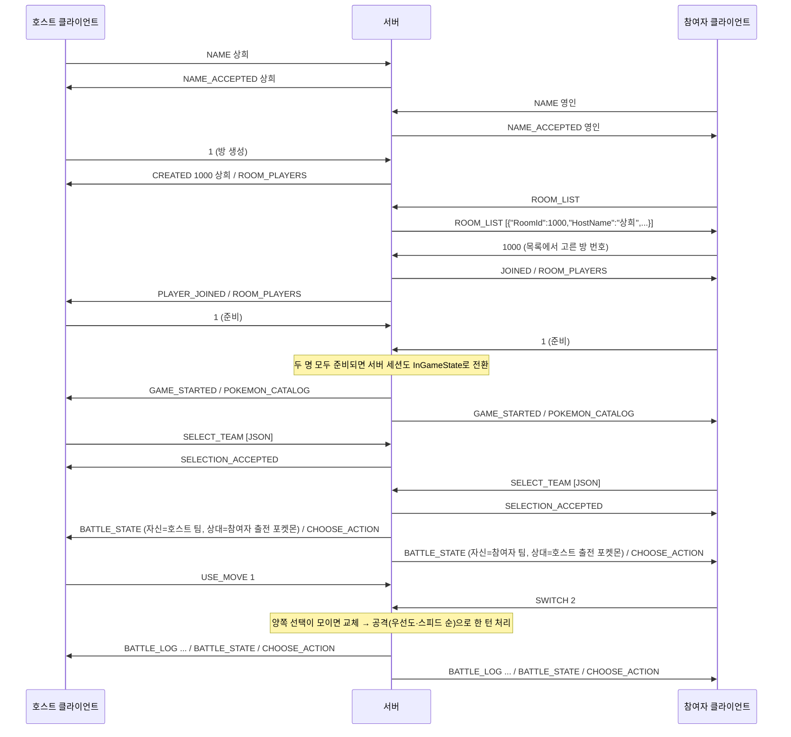

# Pokemon

C# / .NET 10 기반의 TCP 콘솔 포켓몬 게임입니다. 서버가 방과 플레이어 정보를 관리하고, 클라이언트는 사용자 입력을 전송하고 서버 응답에 따라 화면을 표시합니다.

현재는 닉네임 설정, 로비의 방 목록에서 골라 입장, 두 플레이어의 준비, 포켓몬 3마리와 각각의 기술 4개 선택, 동시 선택 방식의 턴제 전투(공격·교체·기절 시 교체·항복), 승패 표시와 결과 화면의 재도전·나가기까지 구현되어 있습니다. 포켓몬 데이터는 **6세대(XY·ORAS) 기준**입니다. 팀에는 전국도감 1~721번과 6세대까지 나온 폼만 넣을 수 있고, 습득 기술·기술 값·종족값도 6세대 값을 씁니다(페어리 포함 18타입, [DB 설명](Server/resources/db/README.md)).

**게임 로직을 추가할 때는 클라이언트와 서버의 `InGameState.cs`에서 시작합니다.** 클라이언트는 입력·결과 수신·화면 상태 갱신을, 서버는 명령 검증과 게임 진행 처리를 담당합니다.

## 프로젝트 구성

| 경로 | 역할 |
| --- | --- |
| [Client/Program.cs](Client/Program.cs) | 서버 연결, 입력·수신 이벤트 수집, 단일 이벤트 처리 루프 |
| [Client/scripts/States](Client/scripts/States) | 닉네임·로비·방 안·게임 중 상태별 입력 및 서버 메시지 처리 |
| [Client/scripts/Renderers](Client/scripts/Renderers) | 인게임 화면 구성, 텍스트·타입 색상·포켓몬 그림 출력 |
| [Server/Program.cs](Server/Program.cs) | DB 로딩, TCP 연결 수락, 접속별 세션 실행 |
| [Server/scripts/ClientSession.cs](Server/scripts/ClientSession.cs) | 접속 하나의 명령 수신, 상태 위임, 응답 송신 |
| [Server/scripts/States](Server/scripts/States) | 서버에서 플레이어 상태별 명령 처리 |
| [Server/scripts/RoomManager.cs](Server/scripts/RoomManager.cs) | 방 생성·입장·퇴장, 준비, 포켓몬 선택 검증 및 양쪽 통지 |
| [Server/scripts/GameRoom.cs](Server/scripts/GameRoom.cs) | 호스트·참여자와 각자의 포켓몬 선택 보관 |
| [Shared/GameMessages.cs](Shared/GameMessages.cs) | 양쪽 프로젝트가 함께 사용하는 JSON 데이터 형식 |
| [Server/tools/build_db.py](Server/tools/build_db.py) | PokéAPI CSV로 포켓몬 DB를 다시 만드는 스크립트 |
| [Shared/CatalogCodec.cs](Shared/CatalogCodec.cs) | 포켓몬 목록 메시지의 압축(서버)·압축 풀기(클라이언트) |

## 통신 규칙

- 클라이언트마다 서버와 하나의 TCP 연결을 유지합니다. 방에서 나가도 연결을 유지하며, 다시 방을 만들거나 입장할 수 있습니다.
- 송신 문자열은 UTF-8로 인코딩하며, **줄바꿈(`\n`)으로 메시지 하나의 끝을 구분합니다.** JSON 데이터도 줄바꿈 없는 한 줄로 직렬화합니다.
- 클라이언트의 `StreamWriter`는 `AutoFlush = true`이므로 `WriteLineAsync()`로 보낸 명령이 바로 전송됩니다.
- 서버는 수신 데이터를 줄바꿈까지 모읍니다. TCP 수신 한 번에 명령이 나뉘거나 여러 개가 함께 들어와도 줄 단위로 처리합니다. CRLF의 `\r`도 제거합니다.
- 서버는 받은 바이트를 줄바꿈 단위로 자른 뒤 한 줄씩 UTF-8로 디코딩합니다. UTF-8에서 줄바꿈 바이트는 여러 바이트 글자 안에 나오지 않으므로, 한글 닉네임이 TCP 수신 경계에서 나뉘어도 깨지지 않습니다.
- 서버가 받는 명령은 줄바꿈을 제외하고 최대 256**바이트**입니다(한글은 한 글자에 3바이트). 초과하면 연결을 종료합니다. 서버에서 클라이언트로 보내는 목록 메시지에는 이 제한을 적용하지 않습니다.
- 오류는 `ERROR 설명` 형식으로 보냅니다. 연결 종료는 스트림의 EOF로 감지합니다.

서버는 기본 포트 `5050`을 사용하며 실행 인자로 포트를 변경할 수 있습니다. macOS에서는 AirPlay 수신기가 `5000`, `7000`번 포트를 사용하므로 이 포트는 피합니다. 클라이언트는 `host`, `port` 인자로 접속 대상을 지정하며, 생략하면 `127.0.0.1:5050`에 접속합니다. `host`에는 IPv4 주소나 호스트 이름을 쓸 수 있습니다.

```bash
dotnet run --project Server                          # 포트 5050
dotnet run --project Server -- 6000                  # 포트 지정
dotnet run --project Client                          # 127.0.0.1:5050
dotnet run --project Client -- 192.168.0.10 5050     # 다른 컴퓨터의 서버
```

## 상태별 명령

클라이언트와 서버 모두 `ClientState` 추상 클래스를 상속하는 `NicknameState`, `LobbyState`, `InRoomState`, `InGameState` 객체를 사용합니다. 접속하면 `NicknameState`에서 시작합니다. 같은 숫자도 현재 상태에 따라 의미가 달라집니다.

| 상태 | 사용자 입력 | 서버에 전송하는 명령 | 처리 |
| --- | --- | --- | --- |
| Nickname | 닉네임 | `NAME <닉네임>` | 띄어쓰기 없이 1~8글자. 접속 중인 다른 플레이어와 겹치면 거절. 연결이 끊기면 다시 쓸 수 있음 |
| Lobby | `1` | `1` | 방 생성 |
| Lobby | `2` | `ROOM_LIST` | 방 목록 요청. 방 목록 화면으로 전환 |
| Lobby (방 목록) | 목록 번호 | 그 방의 방 번호, 예: `1000` | 방 입장. 게임 중이거나 가득 찬 방은 클라이언트가 막음 |
| Lobby (방 목록) | Enter | `ROOM_LIST` | 새로고침. `0`은 로비 메뉴로 돌아가며 서버에 보내지 않음 |
| Lobby | `3` | `3` | 클라이언트 종료 |
| InRoom | `1` | `1` | 준비 |
| InRoom | `2` | `2` | 방에서 나가기 |
| InGame | 포켓몬 번호 3개 → 포켓몬마다 기술 번호 4개 | `SELECT_TEAM [JSON]` | 서로 다른 포켓몬 3마리를 먼저 고르고(같은 종은 폼이 달라도 한 마리), 고른 순서대로 기술을 고른 뒤 한 번에 전송 |
| InGame (행동 선택) | `1` 싸운다 → 기술 `1`~`4` | `USE_MOVE <1~4>` | 출전 중인 포켓몬의 기술 슬롯 사용. `0`은 뒤로 |
| InGame (행동 선택) | `2` 교체 → 목록 번호 | `SWITCH <1~3>` | 출전하지 않았고 쓰러지지 않은 포켓몬으로 교체. `0`은 뒤로 |
| InGame (턴 도중 교체) | 목록 번호 | `SWITCH <1~3>` | 유턴·볼트체인지·막말내뱉기·배턴터치를 쓴 뒤(`CHOOSE_SWITCH_MIDTURN`) 내보낼 포켓몬. 취소할 수 없음 |
| InGame (기절 후) | 목록 번호 | `SWITCH <1~3>` | 쓰러진 포켓몬 대신 내보낼 포켓몬. 뒤로 갈 수 없음 |
| InGame (행동 선택·대기) | `3` 항복 → `1` 확인 | `SURRENDER` | 전투를 끝내고 상대가 승리. 양쪽 모두 결과 화면으로 이동. 확인에서 `0`은 뒤로. 상대의 행동을 기다리는 중에도 `3`으로 항복 가능 |
| InGame (결과 화면) | `1` 재도전 | `REMATCH` | 양쪽 모두 신청하면 포켓몬 선택부터 다시 시작 |
| InGame (결과 화면) | `2` 나가기 | `LEAVE` | 방에서 나가 로비로 이동. 전투 중에 보내면 항복으로 처리 |

포켓몬 선택 단계의 포켓몬 번호와 기술 번호는 DB의 ID입니다. 포켓몬 번호는 폼 번호로, 기본 폼은 전국도감 번호이고 리전폼 등 다른 폼은 10001 이후 번호입니다(예: 알로라 라이츄 10100). 메가진화·거다이맥스처럼 전투 중에만 되는 폼은 고를 수 없습니다. `USE_MOVE`의 숫자는 출전 중인 포켓몬의 기술 4개 중 몇 번째 슬롯인지, `SWITCH`의 숫자는 팀 번호(선택한 순서 1~3)를 뜻합니다. 클라이언트 교체 목록의 번호는 교체 가능한 포켓몬만 다시 매긴 것이므로 팀 번호로 바꿔서 보냅니다.

## 서버 응답

`{...}`와 `<...>`는 설명을 위한 자리표시자입니다. 실제 메시지에는 해당 값이나 JSON이 들어갑니다.

| 메시지 | 의미와 클라이언트 처리 |
| --- | --- |
| `NAME_ACCEPTED <닉네임>` | 닉네임 설정 완료. `LobbyState`로 전환 |
| `ROOM_LIST [JSON]` | 방 목록(`RoomSummary` 배열: 방 번호, 방장 닉네임, 인원, 게임 중 여부). 방 번호 순. 화면에는 `<방장 닉네임>의 방`으로 표시 |
| `CREATED <방 번호> <방장 닉네임>` | 생성 완료. `InRoomState`로 전환 |
| `JOINED <방 번호> <방장 닉네임>` | 입장 완료. `InRoomState`로 전환 |
| `PLAYER_JOINED` | 상대 입장 알림 |
| `PLAYER_LEFT` | 상대 퇴장·연결 종료 알림. 결과 화면에서 받으면 재도전할 수 없음 |
| `ROOM_PLAYERS <방 번호> <방장 닉네임> <준비> [참여자 닉네임] [준비]` | 현재 플레이어 목록. 준비 값은 `0` 또는 `1`. 참여자가 없으면 참여자 부분 생략 |
| `READY` | 자신의 준비 완료 |
| `PLAYER_READY` | 상대방의 준비 완료 |
| `LEFT` | 자신의 퇴장 완료. `LobbyState`로 전환 |
| `ROOM_CLOSED` | 방 안이나 포켓몬 선택 중에 호스트가 나가서 방 종료. 참여자는 `LobbyState`로 전환 |
| `GAME_STARTED` | 두 플레이어 모두 준비 완료. `InGameState`로 전환. 포켓몬·기술 선택 제한시간 5분(300초) 시작 |
| `POKEMON_CATALOG <Base64>` | 포켓몬·타입·기술·배울 수 있는 기술 목록. JSON을 Brotli로 압축하고 Base64로 바꾼 한 줄(아래 "포켓몬 목록 압축") |
| `SELECTION_ACCEPTED` | 자신의 포켓몬·기술 선택 승인 |
| `BATTLE_STATE {JSON}` | 전투 화면 정보(`BattleView`). 내 팀 3마리(HP·기술), 출전 번호, 상대 출전 포켓몬, 날씨·필드·공간 효과와 남은 턴(`FieldEffects`, 예: `["날씨: 비 (4턴)", "트릭룸 (2턴)"]`). 첫 수신 시 전투 화면으로 전환하고, 교체·각 공격·턴 끝 처리 후의 중간 결과를 각각 전송 |
| `BATTLE_LOG <문장>` | 받는 플레이어 시점의 전투 기록. 예: `내 파이리의 화염방사! 효과가 굉장했다! (180 데미지)` |
| `BATTLE_EFFECT <타입 ID> <색상 RGB> <타입 이름> <SELF\|OPPONENT> <상성 배율>` | 공격 효과. `Client/resources/type_scripts/{타입 ID 두 자리}_attack_image.txt`의 컬러 문자 아트를 공격 방향에 맞춰 표시. 상성 배율은 서버 계산값이며, 빗나감·무효·미구현 공격은 0을 보내 타격음을 생략 |
| `BATTLE_STATUS <상태 코드> <SELF\|OPPONENT>` | 상태이상 부여·발동 연출. 대상 포켓몬 기준으로 상태 타입 이미지를 덧그렸다가 지우며, 상태별 효과음을 재생 |
| `BATTLE_STAT <기술 타입 ID> <UP\|DOWN> <SELF\|OPPONENT>` | 능력치 랭크 변화 연출. 실제로 변한 대상 위에 사용 기술의 타입 이미지를 덧그리며, 증가·감소 방향에 맞는 효과음을 재생 |
| `BATTLE_BUFF <기술 타입 ID> <SELF\|OPPONENT>` | 자신·우리 편 버프가 성공했을 때 사용자 위에 기술 타입 이미지를 덧그렸다가 복원하고 랭크 업 효과음을 재생 |
| `BATTLE_HEAL <SELF\|OPPONENT>` | 실제로 HP가 회복됐을 때 양쪽 클라이언트에서 회복 효과음을 재생. 앞선 공격·상태이상 연출이 있으면 그 뒤에 처리 |
| `CHOOSE_ACTION` | 이번 턴 행동(싸운다/교체) 선택. 받은 순간부터 60초 |
| `CHOOSE_SWITCH` | 출전 포켓몬이 쓰러짐. 내보낼 포켓몬 선택. 받은 순간부터 60초 |
| `CHOOSE_SWITCH_MIDTURN` | 유턴·볼트체인지·막말내뱉기·배턴터치를 써서 턴 도중에 교체. 내보낼 포켓몬 선택. 받은 순간부터 60초 (넘기면 팀 순서가 가장 앞인 포켓몬). 고르면 남은 턴이 이어서 진행됨 |
| `WAIT_SWITCH` | 상대가 쓰러진 포켓몬 대신, 또는 턴 도중 교체로 내보낼 포켓몬을 고르는 중 |
| `LOCKED` | 이번 턴 행동이 정해져 있음(난동 기술·구르기·아이스볼·참기·소란피기, 2턴 기술의 공격 턴, 파괴광선 등의 반동으로 쉬는 턴). 선택 없이 대기 |
| `BATTLE_END <WIN\|LOSE\|DRAW> [SURRENDER\|LEFT\|TIMEOUT]` | 전투 종료. 결과 화면에 재도전·나가기 메뉴 표시. 한쪽 팀 3마리가 모두 쓰러지면 이유 없이 보내고, 턴 끝 데미지로 양쪽이 함께 전멸하면 `DRAW`(상대의 마지막 포켓몬을 쓰러뜨린 턴에도 턴 끝 처리를 하므로, 그 데미지로 자신도 전멸하면 `DRAW`. 본가 게임은 쓰러뜨린 쪽이 이기지만 이 게임은 무승부로 정함). 항복으로 끝나면 `SURRENDER`, 상대가 나가거나 연결이 끊겨서 끝나면 `LEFT`(남은 쪽 `WIN`), 제한시간을 넘겨서 끝나면 `TIMEOUT`(양쪽 모두 넘기면 `DRAW`)이 붙음. 포켓몬 선택 시간 초과로 끝나면 전투 화면 없이 바로 보냄 |
| `REMATCH_REQUESTED` | 자신의 재도전 신청 완료. 상대의 신청을 기다림 |
| `PLAYER_REMATCH` | 상대가 재도전을 신청함 |
| `REMATCH_STARTED` | 양쪽 모두 재도전을 신청함. 포켓몬 선택 화면으로 돌아감. 포켓몬 목록은 다시 보내지 않으므로 클라이언트가 이전 목록을 사용 |
| `RETURN_TO_ROOM <방 번호> <방장 닉네임>` | 포켓몬 선택 중에 참여자가 나갔을 때 호스트를 `InRoomState`로 복귀 |
| `ERROR <설명>` | 명령 오류 또는 선택 검증 실패. 사슬묶기·도발 등으로 쓸 수 없는 기술을 고르면 `ERROR 도발 때문에 칼춤을 쓸 수 없습니다.`처럼 이유를 보내며, `CHOOSE_ACTION` 상태 그대로 다시 고름 |

닉네임에는 띄어쓰기가 없으므로 메시지를 띄어쓰기로 나눠 읽을 수 있습니다. 서버 콘솔 기록에는 닉네임과 함께 `IP:포트` 주소를 남깁니다.

공격 연출은 서버에서 받은 공격 순서대로 재생합니다. 이미지 이동·도착에 0.5초를 쓰고,
이미지가 사라진 뒤 피격 포켓몬을 공백으로 지웠다가 원래 색상으로 다시 그리는 과정을
0.16초 간격으로 3회 반복합니다(0.96초).
공격 한 번의 깜빡임이 끝날 때마다 그 공격의 HP·상태·능력치·전투 기록을 반영한 뒤 다음 공격을 시작합니다.
턴 끝 처리와 승패 표시도 마지막 연출이 끝난 뒤 진행합니다.
연출 중에는 다음 행동 입력을 받지 않으며, 다음 턴의 선택 마감은 서버 안내를 실제로 받은 시각을 기준으로 계산합니다.

효과음은 `SoundManager` 초기화 시 등록합니다. 양쪽 포켓몬 모두 피격 깜빡임이 시작될 때 상성이
1배 미만(0.25·0.5배)이면 `hit_weak`, 1배이면 `hit_normal`, 1배 초과(2·4배)이면 `hit_super`를 한 번 재생합니다.
내 출전 포켓몬의 HP가 0보다 크고 최대 HP의 20% 이하인 구간에 진입하면 `health_low`를 한 번 재생하며,
회복해서 구간을 벗어났다가 다시 내려오거나 저체력 포켓몬으로 교체하면 다시 재생합니다.
상대 포켓몬의 HP 변화만으로는 저체력 경고음을 재생하지 않습니다.
양쪽 출전 포켓몬이 쓰러질 때는 `faint`를 재생합니다. HP 관련 효과음도 공격 연출 뒤의 상태 반영 순서를 따릅니다.
같은 효과음이 아직 재생 중이면 중복 요청을 무시하며, 양쪽이 한꺼번에 쓰러지면 쓰러짐 소리는 한 번만 요청합니다.
저체력음은 회복·교체·쓰러짐·전투 종료로 경고 조건이 해제되면 중단합니다.
실제로 HP가 회복되면 `In-Battle Held Item Activate.mp3`를 먼저 재생하고, 실제 재생 완료 후 `In-Battle Heal HP Restore.mp3`를 재생합니다.
고정 시간 대기 대신 FMOD 채널의 재생 완료를 확인하며, 같은 회복음이 대기·재생 중일 때는 중복 요청을 무시합니다.
Held Item Activate 재생 중에는 회복 이미지를 표시하지 않고, Heal HP Restore가 시작되면 회복한 포켓몬 위에
`Client/resources/effect_scripts/heal_image.txt`의 초록·연두색 다이아몬드를 표시합니다.
회복음이 끝나면 원래 그림을 복원하고 0.56초 뒤 다음 기술·HP 갱신·턴 안내를 반영합니다.
오디오를 사용할 수 없어도 회복 이미지는 최소 0.64초 표시하고 정상 진행합니다.
HP회복·날개쉬기·잠자기·꿀꺽 등 직접 회복,
아픔나누기로 HP가 증가한 쪽, 희망사항·아쿠아링·뿌리박기의 실제 회복 시점에 적용하며, 양쪽 포켓몬 모두 해당됩니다.
HP가 가득 차 있거나 기술이 실패해 회복되지 않았을 때는 재생하지 않습니다.
능력치를 바꾸는 변화기는 실제 랭크 변화가 있으면 대상 포켓몬 위에 사용 기술의 타입 이미지를 덧그렸다가 복원합니다.
대상과 관계없이 실제 랭크가 오르면 `stat_up`, 내리면 `stat_fall`을 재생합니다.
여러 능력치가 같은 방향으로 바뀌면 기술 한 번당 대상별로 연출을 한 번만 재생하며,
껍질깨기처럼 상승·하락이 함께 있으면 각각 한 번씩 순서대로 재생합니다.
흰안개·방어·빗나감·랭크 한계 등으로 실제 변화가 없으면 해당 방향의 연출을 생략합니다.
기충전의 급소 랭크 상승도 포함하며, 배턴터치의 교체·랭크 전달은 증감 연출로 처리하지 않습니다.
변화기와 상태이상 연출은 같은 표시·복원 시간과 순서 제어를 사용하고, 다음 연출 시작 시 앞선 연출의 효과음을 중단해 겹치지 않게 합니다.

빛의장막·리플렉터·순풍·흰안개·주술·신비의부적, 방어·판별·버티기·패스트가드·매직코트·대타,
희망사항·아쿠아링·뿌리박기 등 자신·우리 편에 거는 효과도 성공하면 사용자 위에 기술 타입 이미지를 표시하고 `stat_up`을 재생합니다.
랭크가 한계여도 비축하기·충전의 별도 효과가 새로 생기면 같은 버프 연출을 표시합니다.
이미 활성화되어 실패하거나, 마지막 행동·연속 사용 확률·체력 부족 등으로 실패하면 버프 연출을 생략합니다.
같은 기술의 랭크 업 연출이 이미 있으면 버프 연출을 추가하지 않아 이미지와 소리가 두 번 재생되지 않습니다.

상태이상에 실제로 걸리면 서버가 `BATTLE_STATUS`를 보냅니다. 독·맹독·화상의 턴 끝 피해,
잠들거나 얼어서 행동하지 못할 때, 마비로 행동이 막힐 때, 혼란·헤롱헤롱이 지속될 때도 같은 연출을 보냅니다.
하품의 졸음 부여와 이후 잠듦, 잠자기로 스스로 잠드는 경우도 해당 대상을 기준으로 처리합니다.
빗나감·면역·방어·신비의부적 등으로 부여에 실패했을 때는 성공 연출을 보내지 않습니다.
이미지는 이동시키지 않고 대상 포켓몬 중앙에 0.48초간 덧그립니다. 이후 0.56초간 원래 그림을 복원한 뒤
다음 공격·HP 갱신·교체·쓰러짐·승패를 순서대로 반영합니다. 상태 효과음은 연출 시작에 한 번 재생하며,
별도의 새 발동이 오면 이전 동일 효과음을 중단하고 다시 재생해 겹치지 않게 합니다.

| 상태 | 기존 타입 이미지 | 효과음 |
| --- | --- | --- |
| 독·맹독 | 독(4) | `Status Poisoned.mp3` |
| 화상 | 불꽃(10) | `Status Burned.mp3` |
| 마비 | 전기(13) | `Status Paralyzed.mp3` |
| 얼음 | 얼음(15) | `Status Frozen.mp3` |
| 잠듦·하품 | 에스퍼(14) | `Status Sleep.mp3` |
| 혼란 | 에스퍼(14) | `Status Confused.mp3` |
| 헤롱헤롱 | 페어리(18) | 전용 파일이 없어 이미지 연출만 표시 |

쓰러진 포켓몬은 0.04초마다 한 줄씩 아래로 내려갑니다. 그림의 원래 바닥 아래는 그리지 않아
맨 아래 줄부터 차례로 사라지며, 완전히 숨긴 상태는 다음 포켓몬으로 교체할 때까지 유지합니다.
교체 메뉴가 열려 있었더라도 쓰러짐 중에는 대기 상태로 바꾸며, 완전히 사라진 프레임을 표시하고 교체 안내를 반영한 뒤 입력을 받습니다.
마지막 포켓몬도 이 연출을 모두 마친 뒤 승패 화면을 표시합니다.

기본 상태의 두 포켓몬은 원래 위치와 한 줄 위를 0.4초 간격으로 오가며 계속 움직입니다(한 주기 0.8초).
공격·피격 연출 중에는 원래 위치에서 멈추고, 연출이 끝나면 기본 움직임을 다시 시작합니다.

## 준비부터 포켓몬 표시까지



`SELECT_TEAM`의 형식 예시는 다음과 같습니다. 첫 번째 포켓몬이 먼저 출전합니다. 3마리 모두 길이 256바이트 제한 안에 들어갑니다.

```text
SELECT_TEAM [{"PokemonId":4,"MoveIds":[53,394,200,264]},{"PokemonId":25,"MoveIds":[85,87,98,231]},{"PokemonId":7,"MoveIds":[57,56,401,55]}]
```

서버는 포켓몬 수(3마리), 같은 종 중복, 팀에 넣을 수 있는 폼인지, 기술 개수·중복·습득 가능 여부를 검증합니다. 먼저 선택한 플레이어는 상대방의 선택을 기다립니다. 양쪽 선택이 완료되면 각 클라이언트의 관점에 맞춘 `BattleView`를 전송합니다.

각 포켓몬의 기술 선택 화면에서 `0`을 입력하면 배울 수 있는 기술 중 서로 다른 4개를 무작위로 골라 확정합니다.
일부 기술을 직접 골랐더라도 4개 전체를 다시 뽑으며, 선택된 기술 이름을 안내한 뒤 다음 포켓몬으로 넘어갑니다.
세 번째 포켓몬까지 확정하면 기존 수동 선택과 동일하게 팀을 서버에 제출합니다.

공통 데이터 정의는 [Shared/GameMessages.cs](Shared/GameMessages.cs)에 있습니다. 포켓몬·기술·전투 결과의 전송 필드를 추가할 때는 이 파일도 함께 변경합니다.

### 포켓몬 목록 압축

게임이 시작될 때 보내는 포켓몬 목록(`POKEMON_CATALOG`)은 팀에 넣을 수 있는 폼 748개와 그 폼들이 배우는 기술 613개라서 가장 큰 메시지입니다(JSON 389,454B → Brotli·Base64 53,629B, −86%). 같은 필드 이름과 타입 정보(`{"TypeId":10,"Name":"불꽃","ColorRgb":"#EE8130"}`)가 포켓몬·기술마다 반복되므로 압축이 잘 됩니다. [CatalogCodec](Shared/CatalogCodec.cs)이 다음 순서로 변환하며, 서버와 클라이언트가 같은 파일을 씁니다.

| 단계 | 1,139폼 (6세대 기준으로 바꾸기 전) | 압축을 넣을 때 (649마리) |
| --- | --- | --- |
| 이전: JSON, 한글을 `\uC0C1`처럼 6바이트로 변환 | 568,315B | 229,678B |
| 한글을 UTF-8(3바이트) 그대로 사용 | 530,817B | 208,523B |
| Brotli 압축 (`CompressionLevel.SmallestSize`) | 62,388B | 26,402B |
| Base64 (보내는 크기, 줄바꿈 포함) | **83,201B (−85%)** | **35,221B (−85%)** |

- 프로토콜이 줄바꿈으로 메시지를 나누는 텍스트라서, 압축한 바이트에 줄바꿈 바이트가 섞이지 않도록 Base64로 바꿉니다(+33%).
- 가장 작게 압축하는 단계는 약 160ms가 걸리지만 서버 시작 시 한 번만 만들고, 게임마다 같은 문자열을 보냅니다. 클라이언트의 압축 풀기는 1ms 미만입니다. 서버를 시작하면 콘솔에 압축 전후 크기를 출력합니다.
- 649마리 데이터로 비교했을 때 gzip은 가장 작게 압축해도 Base64 후 43,420B였습니다.
- 재도전할 때는 목록을 다시 보내지 않고 클라이언트가 가진 목록을 씁니다.

## 클라이언트의 이벤트 처리와 렌더링

전투 화면은 양쪽 포켓몬 그림 아래에 타입 색상 표식·이름·상태이상과 HP 바를 담은 정보 상자를 표시합니다.
HP 바는 50% 초과에서 초록, 20% 초과~50% 이하에서 주황, 20% 이하에서 빨강입니다.
내 정보 상자 아래에는 타입 표식이 있는 기술 네 개를 2행 2열로 표시하며, 교체를 고르면 같은 위치에 교체 목록을 표시합니다.
싸운다·교체의 취소 안내는 기존 입력 문구 뒤에 `(0 : 취소)`로 표시하며, 목록 상자에는 넣지 않습니다. 기절 후 교체와 턴 도중 교체(유턴·배턴터치 등)에는 취소 안내를 표시하지 않습니다.
능력치 변화는 내 두 상자 오른쪽과 상대 정보 상자 왼쪽에 세로로 표시합니다. 상대 기술 목록은 공개하지 않습니다.
충분한 크기의 터미널을 전제로 배치합니다.

```text
콘솔 입력 ── ReadInputEventsAsync ─┐
                                 ├─ Channel<ClientEvent> ─ ProcessEventsAsync
서버 응답 ── ReceiveMessagesAsync ┘                           │
                                                            ├─ state.HandleCommand(...)
                                                            ├─ state.HandleServerMessage(...)
                                                            └─ state.ShowMenu()
```

입력·수신 작업은 이벤트를 큐에 넣기만 합니다. 단일 처리 루프가 현재 상태에 이벤트를 위임하고, 처리가 끝나면 화면을 다시 그립니다. 상태 변경과 메뉴 출력을 다른 작업에서 동시에 수행하지 않습니다.

`InGameState.ShowMenu()`는 [InGameRenderer](Client/scripts/Renderers/InGameRenderer.cs)에 화면 구성을 위임합니다.

전투 출력은 [ConsoleRenderThreads](Client/scripts/Renderers/ConsoleRenderThreads.cs)의 두 전용 스레드로 나눕니다.
`PokemonRenderer` 스레드는 포켓몬·공격 이미지·깜빡임을, `BattleInformationRenderer` 스레드는 HP·상태·메뉴·기록·시간을 그립니다.
공유 콘솔의 커서가 섞이지 않도록 출력 요청 순서를 보장하며, 상태·입력·수신·오디오 이벤트 루프는 출력과 분리됩니다.
각 출력 요청은 해당 시점의 데이터를 복사해 사용하고, 전투에서 나갈 때는 남은 출력을 마친 뒤 다음 메뉴를 표시합니다.

포켓몬·공격 이미지는 [BattleSpriteBuffer](Client/scripts/Renderers/BattleSpriteBuffer.cs)에서 한 프레임으로 합성합니다.
직전 프레임과 달라진 칸만 묶어서 출력하고, 같은 프레임은 출력하지 않습니다.
기본 움직임에서 그림 영역 전체를 비우지 않으며, HP·메뉴 갱신도 아래 정보 영역만 지웁니다.

| 렌더러 | 담당 |
| --- | --- |
| `InGameRenderer` | 포켓몬 목록·기술 목록·선택 대기·두 포켓몬 화면의 배치와 출력 순서 |
| `TextRenderer` | 텍스트 출력, 좌표 출력, 한글 표시 폭과 정렬 |
| `TypeColorRenderer` | 타입 HEX 색상을 적용한 마커 출력, 지정한 색으로 글자 출력 |
| `StatusColorRenderer` | 상태이상 표시(`[마비]` 등, 상태별 색)와 능력치 변화 줄(오름 초록·내림 빨강·기충전 등 파랑) 출력 |
| `PokemonRenderer` | ANSI 컬러 TXT 로딩, 표시 크기 조정, 좌우 반전과 그림 출력 |

알림은 상태의 `Notification`에 저장하고 메뉴와 함께 출력합니다. 렌더러에서는 입력이나 서버 응답을 기다리지 않습니다.

## 게임 로직을 구현할 위치

### 클라이언트: `Client/scripts/States/InGameState.cs`

- `HandleCommand()`: 사용자 입력을 확인하고 서버에 명령을 전송합니다. 전투 중 입력은 `HandleBattleInput()`이 메뉴 단계(싸운다/교체/기술/교체 목록/대기)에 따라 처리합니다.
- `HandleServerMessage()`: 서버가 보낸 전투 결과를 해석하고 `battle` 및 `Notification`을 갱신합니다.
- `ShowMenu()`: 갱신된 상태를 `InGameRenderer`로 전달합니다.

### 서버: `Server/scripts/States/InGameState.cs`

- `HandleCommand()`: 클라이언트의 인게임 명령을 구분하고 형식을 검사합니다.
- 양쪽 선택을 모으는 작업과 방 공유 데이터 변경은 `RoomManager` 등의 서버 로직에 위임합니다.
- 공격 순서, 명중 여부, 데미지, HP, 승패는 서버에서 판정하고 결과를 양쪽 클라이언트에 전달하도록 구현합니다.

타입 상성에 따른 데미지 배율은 [Server/scripts/GameData.cs](Server/scripts/GameData.cs)의 `GetMultiplier(int attackTypeId, int defendTypeId)`로 조회할 수 있습니다. 공격 기술의 타입 ID와 방어 포켓몬의 타입 ID를 순서대로 전달하면 두 타입의 상성 배율을 `double`로 반환합니다.
GameData 객체의 경우 RoomManager 객체가 소유하고 있습니다.
상태이상 정보나 기술의 상태이상 적용 확률도 DB에 저장되어 있습니다. DB 테이블의 구조를 확인하려면 VSCode의 SQLite Viewer 플러그를 설치하시면 됩니다.

```csharp
double multiplier = data.GetMultiplier(move.TypeId, defender.Type1Id);
```

기술별 상태이상 정보는 `data.MoveStatusEffectsByMoveId[move.Id]`, 상태 정의는 `data.StatusConditionsById[effect.StatusId]`로 조회합니다. 확률뿐 아니라 적용 대상·시점·추첨 그룹도 함께 확인해야 합니다. 데이터 범위와 필드 의미는 [DB 설명](Server/resources/db/README.md)에 정리되어 있습니다. 이 데이터로 8종 상태이상의 적용·해제와 턴 처리를 [RoomManager.Status.cs](Server/scripts/RoomManager.Status.cs)에서 구현했습니다(아래 "상태이상" 참고).

예를 들어 기술 사용 기능은 다음 순서로 추가합니다.

```text
클라이언트 InGameState.HandleCommand
→ USE_MOVE <1~4 슬롯> 전송
→ 서버 InGameState.HandleCommand
→ RoomManager.UseMove / SwitchPokemon에서 전투 상태 검증 및 양쪽 선택 수집
→ 서버에서 턴 계산 후 결과 전송
→ 클라이언트 InGameState.HandleServerMessage에서 상태 갱신
→ 이벤트 처리 루프가 화면 출력
```

### 현재 구현된 전투

- 양쪽 팀 선택이 끝나면 서버가 플레이어마다 [BattleSide](Server/scripts/BattleSide.cs)(팀, 출전 번호, 이번 턴 선택)를 만들고, 포켓몬마다 [BattlePokemon](Server/scripts/BattlePokemon.cs)을 만듭니다. 레벨 50, 개체값 31(6V), 노력치 0, 성격 보정 없이 실제 능력치를 계산합니다(HP = 종족값 + 75, 나머지 = 종족값 + 20).
- 매 턴 양쪽이 동시에 기술(`RoomManager.UseMove`) 또는 교체(`RoomManager.SwitchPokemon`)를 고릅니다. 둘 다 고르면 `RoomManager.TryResolveTurn`이 교체를 먼저 처리한 뒤, 우선도 → 스피드 → 무작위 순으로 공격합니다. 그래서 상대가 교체하면 공격은 새로 나온 포켓몬이 맞습니다.
- 이번 턴에 먼저 쓰러진 포켓몬은 공격하지 못합니다. 쓰러진 쪽은 다음 포켓몬을 골라야 하며(`CHOOSE_SWITCH`), 이 교체는 턴을 쓰지 않아 상대가 추가로 공격하지 않습니다. 팀 3마리가 모두 쓰러지면 패배입니다.
- 전투 규칙은 **6세대 기준**입니다. 데미지는 6세대 공식으로 계산합니다(`RoomManager.CalculateDamage`). 물리/특수 구분, 타입 상성(듀얼 타입은 곱함), 자속 1.5배, 난수 0.85~1.00, 명중률, 능력치 랭크, 급소, 날씨·필드를 반영합니다. 특성·아이템·PP는 이 게임에 없습니다.
- 6세대 기준으로 배울 수 있는 기술 613개를 모두 구현했습니다. 다만 기술을 하나만 배우는 메타몽(변신)·안농(잠재파워)·루브도(스케치)는 기술 4개를 고를 수 없어서 팀에 넣을 수 없습니다([DB 설명](Server/resources/db/README.md) "테이블").
- 화상이면 물리 기술 데미지가 절반이 됩니다.

### 상태이상 (6세대 규칙)

DB의 `StatusCondition`·`MoveStatusEffect`에 있는 8종을 구현했습니다. 기술 실행과 상태이상 처리는 [RoomManager.Status.cs](Server/scripts/RoomManager.Status.cs), 포켓몬별 상태는 [BattlePokemon](Server/scripts/BattlePokemon.cs)에 있습니다.

| 상태 | 교체 시 | 효과 |
| --- | --- | --- |
| 마비 | 유지 | 스피드 1/4, 행동할 때 25% 확률로 못 움직임 |
| 잠듦 | 유지 (남은 턴도 그대로) | 1~3번 못 움직이고 깨어나는 턴에 행동. 잠자기는 HP 전부 회복 후 정확히 2번 못 움직임 |
| 얼음 | 유지 | 못 움직임. 행동할 때 20% 확률로 녹음. 불꽃 타입 공격이나 열탕·스팀버스트를 맞거나, 화염바퀴·성스러운불꽃·플레어드라이브·열탕·크로스플레임·스팀버스트를 쓰면 녹음 |
| 화상 | 유지 | 턴 끝에 최대 HP 1/8 데미지, 물리 데미지 절반 |
| 독 | 유지 | 턴 끝에 최대 HP 1/8 데미지 |
| 맹독 | 유지 (데미지는 1/16부터 다시) | 턴 끝에 1/16, 2/16, 3/16 ... 데미지 |
| 혼란 | 풀림 | 1~4번 행동하는 동안 50% 확률로 자신을 공격(위력 40 물리) |
| 헤롱헤롱 | 풀림 (상대가 교체·기절해도 풀림) | 50% 확률로 못 움직임. 성별이 없어서 항상 걸림 |

- 교체해도 남는 상태이상(혼란·헤롱헤롱 제외)은 한 번에 하나만 걸립니다. 전기 타입은 마비, 불꽃 타입은 화상, 얼음 타입은 얼음, 독·강철 타입은 독·맹독에 걸리지 않습니다.
- 풀 타입은 가루·포자 기술(독가루·저리가루·수면가루·버섯포자·목화포자·분노가루·분진)에 효과가 없습니다. 독 타입이 쓰는 맹독은 반드시 맞습니다.
- 행동 순서 판정: 잠듦 → 얼음 → 풀죽음 → 혼란 → 헤롱헤롱 → 마비. 턴 끝 처리: 화상·독·맹독 데미지 → 하품. 화상·독 데미지는 출전 중인 포켓몬만 받습니다.
- 공격 기술의 추가 효과(예: 10만볼트 마비 10%)는 맞고 쓰러지지 않았을 때 판정합니다. 트라이어택처럼 같은 `effect_group`인 효과는 그중 하나만 추첨합니다.
- 상태이상 변화 기술은 명중률 판정 후 적용하며, 이미 걸려 있거나 면역이면 "하지만 실패했다!"가 나옵니다. 전기자석파는 땅 타입에게 효과가 없습니다.
- 하품: 다음 턴이 끝날 때 잠듭니다.
- **치료방울·아로마테라피:** 교체로 들어가 있는 포켓몬까지 우리 팀 전체의 상태이상을 고칩니다(혼란·헤롱헤롱은 그대로). 고칠 것이 없으면 실패합니다.
- **사이코시프트:** 내 상태이상을 상대에게 옮기고 나는 낫습니다. 내 상태이상이 없거나, 상대가 이미 상태이상이거나 면역이거나, 대타·신비의부적이 있으면 실패합니다.
- **잠꼬대:** 잠든 동안 자신의 다른 기술 하나를 무작위로 씁니다. 잠꼬대 자신·2턴 기술(솔라빔·구멍파기 등)·소란피기·힘껏펀치 등은 나오지 않습니다(`SleepTalkBannedMoveIds`). 잠꼬대로 나온 난동 기술은 고정되지 않습니다.
- **상태이상이면 위력 2배:** 객기(자신이 화상·독·마비, 화상이어도 데미지가 줄지 않음), 병상첨병(상대가 상태이상), 베놈쇼크(상대가 독·맹독)
- **리프레시:** 자신의 독·맹독·마비·화상을 고칩니다(잠듦·얼음은 고치지 못함). 고칠 것이 없으면 실패합니다.
- 정신차리기·잠깨움뺨치기는 "위력이 바뀌는 공격기·정해진 데미지", 악몽은 "기술 제한·지속 효과·타입·다른 기술 쓰기"에 정리했습니다.
- 난동부리기·꽃잎댄스·역린: 2~3턴 동안 같은 기술을 자동으로 쓰고(`LOCKED`), 끝나면 자신이 혼란에 빠집니다. 도중에 행동하지 못하면 혼란 없이 끝납니다.
- 화면에는 교체해도 남는 상태이상이 HP 옆에 `[마비]`처럼 표시됩니다.

### 공격기 추가 효과 (6세대 규칙)

DB의 `MoveMeta`·`MoveStatChange`를 읽어 `RoomManager.UseDamagingMove`([RoomManager.Status.cs](Server/scripts/RoomManager.Status.cs))에서 처리합니다. 추가 효과는 실패해도 따로 알리지 않습니다.

- **연속기:** 2~5회 기술은 2·3회 각 1/3, 4·5회 각 1/6. 두번차기 등은 2회 고정. 명중 판정은 첫 타만 하고, 급소는 타격마다 판정합니다. 기록은 `3번 맞았다! (12 + 급소 21 + 13 데미지)`처럼 남습니다. 트리플킥은 타격마다 명중 판정을 하고 위력이 10·20·30으로 오릅니다.
- **상대 능력치 하락:** 사이코키네시스(10% 특방 -1), 로킥(스피드 -1) 등. 확률은 기술당 한 번 판정하고, 상대가 쓰러졌거나 대타가 맞았거나 흰안개가 있으면 없습니다.
- **자신 능력치 변화:** 인파이트·오버히트(하락), 니트로차지·원시의힘(상승) 등. 상대가 쓰러지거나 대타가 맞아도 적용됩니다. 고속스핀의 스피드 +1(8세대부터)은 빼고, 다이아스톰은 6세대 값(방어 +1)을 씁니다.
- **풀죽음:** 이번 턴에 아직 행동하지 않은 상대는 "풀이 죽어 기술을 쓸 수 없다!". 잠듦·얼음 다음, 혼란 전에 판정합니다. 속이기는 나온 뒤 첫 행동에서만 성공합니다.
- **흡수·반동:** 실제로 준 데미지(대타 포함)의 50%(드레인키스·데스윙 75%) 회복 / 25·33·50% 반동. 꿈먹기는 상대가 잠들어 있을 때만 성공합니다.
- **코골기:** 잠들어 있을 때만 쓸 수 있습니다.
- 일격필살기는 "위력이 바뀌는 공격기·정해진 데미지", 묶기 기술은 "교체·설치기·묶기"에 정리했습니다.

### 위력이 바뀌는 공격기·정해진 데미지 (6세대 규칙)

[RoomManager.Power.cs](Server/scripts/RoomManager.Power.cs)에 있습니다. 위력은 `BasePower`, 정해진 데미지는 `FixedDamage`가 계산합니다.

- **조건이 맞으면 위력 2배:** 객기(자신이 화상·독·마비), 병상첨병(상대 상태이상), 베놈쇼크(상대 독), 정신차리기(상대 마비, 맞히면 마비가 풀림), 잠깨움뺨치기(상대 잠듦, 맞히면 깨어남), 리벤지·눈사태(이번 턴에 먼저 맞음), 소금물(상대 HP 절반 이하), 보복(상대가 먼저 행동함), 승부굳히기(상대가 이번 턴에 이미 데미지를 입음), 원수갚기(지난 턴에 우리 편이 쓰러짐), 애크러뱃(지닌 도구가 없어서 항상), 크로스플레임·크로스썬더(이번 턴 바로 앞에 짝 기술이 나옴)
- **따라가때리기:** 상대가 교체하려고 하면 교체하기 전에 위력 2배로 공격합니다. 그 공격으로 쓰러지면 교체하지 않고 턴 끝에 다음 포켓몬을 고릅니다.
- **위력이 바뀌는 기술**

| 기술 | 위력 |
| --- | --- |
| 안다리걸기·풀묶기 | 상대 몸무게 10kg 미만 20 … 200kg 이상 120 |
| 헤비봄버·히트스탬프 | 자신 몸무게가 상대의 2배 미만 40, 2배 60, 3배 80, 4배 100, 5배 이상 120 |
| 바둥바둥·기사회생 | 자신 HP가 적을수록 20~200 |
| 쥐어짜기·묵사발 / 분화·해수스파우팅 | 상대 HP 비율 × 120 / 자신 HP 비율 × 150 |
| 자이로볼 / 일렉트릭볼 | 상대가 빠를수록 (최대 150) / 자신이 빠를수록 40~150 |
| 어시스트파워 / 혼내기 | 자신 / 상대의 오른 랭크 1당 +20 (20부터 / 60부터, 최대 200) |
| 구르기·아이스볼 | 맞히면 5번까지 이어서 쓰고(`LOCKED`) 30부터 2배씩. 웅크리기를 썼으면 다시 2배 |
| 연속자르기 / 에코보이스 | 이어서 맞히면 40·80·160 / 매 턴 이어서 쓰이면(어느 쪽이든) 40씩 올라 최대 200 |
| 매그니튜드 | 4(10)~10(150) 무작위, "매그니튜드 N!" 표시 |
| 프레젠트 | 40%: 40, 30%: 80, 10%: 120, 20%: 상대 HP를 1/4 회복 |
| 토해내기 | 비축 1개당 100. 쓰고 나면 비축과 그로 오른 방어·특수방어가 원래대로 |
| 집단구타 | 쓰러지지 않고 상태이상이 없는 우리 팀 수만큼 때리고, 한 번의 위력은 그 포켓몬의 공격 종족값 / 10 + 5 |
| 은혜갚기·화풀이 | 친밀도가 없는 게임이라 둘 다 가장 강할 때의 위력 102 |
| 내던지기 | 지닌 도구가 없는 게임이라 위력 45로 고정 |
| 잠재파워 | 개체값이 모두 31이라 악 타입, 위력 70 |

- **정해진 데미지** (급소·자속·난수·상성 배율 없이, 효과가 없는지만 봄): 소닉붐 20, 용의분노 40, 지구던지기·나이트헤드 50(레벨), 사이코웨이브 25~75, 분노의앞니 상대 HP의 절반, 죽기살기(상대 HP를 자신의 HP만큼으로, 상대 HP가 더 적으면 실패), 목숨걸기(자신의 HP만큼, 맞히면 자신은 쓰러짐)
- **일격필살:** 가위자르기·뿔드릴·땅가르기·절대영도는 명중률 30(랭크 영향 없음)이고, 맞으면 "일격필살!"로 상대가 쓰러집니다(버티기·대타는 막음).
- **되갚기:** 카운터·미러코트는 이번 턴에 받은 물리·특수 데미지의 2배, 메탈버스트는 1.5배를 돌려줍니다(받지 않았으면 실패). 참기는 2턴 동안 받은 데미지를 모았다가(`LOCKED`) 3번째 턴에 2배로 돌려줍니다.
- **데미지 계산이 다른 기술:** 사이코쇼크·사이코브레이크·신비의칼은 상대의 방어로, 속임수는 상대의 공격과 공격 랭크로 계산합니다. 야금야금·성스러운칼은 상대의 방어·회피율 랭크를 무시합니다. 플라잉프레스는 격투와 비행 상성을 곱하고, 프리즈드라이는 물 타입에게 효과가 굉장하며, 싱크로노이즈는 자신과 같은 타입이 있는 상대에게만 맞습니다.
- **비밀의힘:** 30% 확률로 필드에 따라 마비(필드 없음·일렉트릭필드), 잠듦(그래스필드), 특수공격 -1(미스트필드)

### 공격기의 특수한 동작 (6세대 규칙)

[RoomManager.Attack.cs](Server/scripts/RoomManager.Attack.cs)에 있습니다.

- **자폭·대폭발:** 쓰면 빗나가거나 막혀도 자신이 쓰러집니다.
- **반동으로 쉬기:** 파괴광선·블라스트번·하이드로캐논·하드플랜트·기가임팩트·암석포·시간의포효는 맞히면(대타 포함) 다음 턴에 "공격의 반동으로 움직일 수 없다!"로 쉽니다(`LOCKED`). 빗나가거나 효과가 없으면 쉬지 않습니다.
- **2턴 기술:** 첫 턴에 모으고 다음 턴에 자동으로 공격합니다(`LOCKED`). 도중에 행동하지 못하면(잠듦·마비 등) 취소됩니다.
  - 칼바람·솔라빔·불새·프리즈볼트·콜드플레어: 모으기만 합니다. 솔라빔은 쾌청이면 모으지 않고 바로 쏩니다.
  - 로켓박치기: 모으는 턴에 방어 +1
  - 공중날기·뛰어오르기(공중), 구멍파기(땅속), 다이빙(물속), 섀도다이브·고스트다이브(사라짐): 숨은 동안 상대 기술이 빗나갑니다. 공중에는 바람일으키기·회오리·번개·스카이어퍼·폭풍·떨어뜨리기, 땅속에는 지진·매그니튜드·땅가르기, 물속에는 파도타기·바다회오리가 맞고, 바람일으키기·회오리·지진·매그니튜드·파도타기·바다회오리는 위력 2배입니다. 독 타입이 쓰는 맹독도 맞습니다.
  - 섀도다이브·고스트다이브: 공격하는 턴에 방어를 뚫습니다.
  - 프리폴: 상대를 데리고 날아올라 둘 다 공중에 숨고, 상대는 떨어질 때까지 행동·교체할 수 없습니다. 다음 턴에 떨어뜨려 데미지를 주며, 비행 타입에게는 데미지가 없습니다. 대타가 있거나 200kg 이상인 상대에게는 실패합니다.
- **기습:** 상대가 이번 턴에 아직 행동하지 않았고 공격 기술을 골랐을 때만 성공합니다.
- **힘껏펀치:** 턴이 시작될 때 "기합을 모으기 시작했다!"가 나오고, 기술을 쓰기 전에 공격을 맞으면(대타가 맞은 것은 제외) 실패합니다.
- **미래예지·파멸의소원:** 2턴 뒤 턴이 끝날 때 그 자리의 포켓몬이 맞습니다. 데미지는 맞는 순간 쓴 포켓몬의 능력치로 계산하며, 쓴 포켓몬이 교체되거나 쓰러져도 맞습니다. 방어로 막을 수 없고, 이미 예약돼 있으면 실패합니다.
- **점프킥·무릎차기:** 빗나가거나 방어·타입 상성으로 막히면 최대 HP의 1/2만큼 반동을 받습니다.
- **비장의무기:** 나온 뒤 자신의 다른 기술을 모두 한 번 이상 써야 성공합니다.
- **마지막수단:** 남은 PP가 적을수록 강해지는 기술이지만, PP가 없는 게임이라 PP가 충분할 때의 위력 40으로 씁니다.

### 이 게임에서 항상 실패하는 기술

특성·지닌 도구가 없고 싱글배틀만 하는 게임이라 효과가 없는 기술은 "하지만 실패했다!"로 처리합니다(`FailingMoveIds`, [RoomManager.Status.cs](Server/scripts/RoomManager.Status.cs)).

- **특성:** 역할, 스킬스왑, 위액, 고민씨, 심플빔, 동료만들기
- **도구:** 트릭, 바꿔치기, 리사이클, 금제, 기프트패스, 자연의은혜, 매직룸, 트림(나무열매를 먹은 뒤에만). 내던지기는 실패시키지 않고 위력 45로 고정했습니다("위력이 바뀌는 공격기·정해진 데미지").
- **더블배틀 전용:** 날따름, 분노가루, 도우미, 사이드체인지, 아로마미스트, 자기장조작, 당신먼저, 순서미루기
- **PP:** 원한, 원념 (PP가 없는 게임)

### 날씨·필드 (6세대 규칙)

[RoomManager.Field.cs](Server/scripts/RoomManager.Field.cs)에 있습니다. 기술로 만든 날씨·필드는 쓴 턴을 포함해 5턴 동안 이어지고(턴이 끝날 때 줄어듦), 같은 것이 이미 있으면 실패합니다. 날씨와 필드는 하나씩만 있고 새로 만들면 바뀝니다. 전투 화면 맨 윗줄에 `날씨: 비 (4턴)  필드: 그래스필드 (3턴)  트릭룸 (2턴)`처럼 날씨·필드·트릭룸·중력·원더룸·흙놀이·물놀이·페어리록을 남은 턴(쓴 턴 포함, 턴이 끝날 때 줄어듦)과 함께 표시합니다.

| 날씨 | 효과 |
| --- | --- |
| 비 (비바라기) | 물 기술 1.5배, 불꽃 기술 0.5배. 번개·폭풍이 반드시 맞음 |
| 쾌청 (쾌청) | 불꽃 기술 1.5배, 물 기술 0.5배. 번개·폭풍 명중률 50. 솔라빔을 바로 쏨. 얼음 상태가 되지 않음. 성장이 공격·특수공격 +2 |
| 모래바람 | 바위·땅·강철 타입이 아니면 턴 끝에 최대 HP 1/16 데미지. 바위 타입 특수방어 1.5배 |
| 싸라기눈 | 얼음 타입이 아니면 턴 끝에 최대 HP 1/16 데미지. 눈보라가 반드시 맞음 |

- 날씨가 있으면 웨더볼이 위력 100에 쾌청 불꽃·비 물·모래바람 바위·싸라기눈 얼음 타입이 되고, 비·모래바람·싸라기눈에서는 솔라빔 위력이 절반입니다. 아침햇살·광합성·달빛은 쾌청 2/3, 다른 날씨 1/4을 회복합니다.
- 구멍파기·다이빙으로 숨은 포켓몬은 모래바람·싸라기눈 데미지를 받지 않습니다.
- **필드** (땅에 있는 포켓몬에게만 효과. 비행 타입은 땅에 없지만 날개쉬기를 쓴 턴·뿌리박기·중력 중에는 땅에 있음)
  - 그래스필드: 풀 기술 1.5배, 턴 끝에 최대 HP 1/16 회복, 땅에 있는 상대에게 지진·땅고르기·매그니튜드 위력 절반
  - 미스트필드: 상태이상·혼란·하품에 걸리지 않음(잠자기도 실패), 땅에 있는 상대에게 드래곤 기술 위력 절반
  - 일렉트릭필드: 전기 기술 1.5배, 잠들지 않음(하품·잠자기 포함)
- **중력** (5턴): 명중률 5/3배, 비행 타입도 땅 기술을 맞음. 공중날기·뛰어오르기·프리폴·점프킥·무릎차기·튀어오르기·전자부유·텔레키네시스를 쓸 수 없고, 공중에 있던 포켓몬은 떨어집니다.
- **원더룸** (5턴, 다시 쓰면 끝남): 방어와 특수방어 실제 능력치가 바뀝니다(랭크는 그대로).
- **흙놀이·물놀이** (5턴): 전기·불꽃 기술 위력 1/3
- **플라스마샤워** (우선도 +1): 그 턴에 노말 타입 기술이 전기 타입이 됩니다.
- **페어리록:** 다음 턴에는 양쪽 모두 직접 교체할 수 없습니다(쓰러진 포켓몬 교체는 가능).
- 턴 끝 순서: 날씨 → 미래예지 → 그래스필드 회복 → 희망사항·아쿠아링·뿌리박기 → 씨뿌리기 → 화상·독 → 묶기 → 악몽·저주 → 멸망의노래 → 기술 제한 등의 남은 턴 → 하품 → 우리 편 효과 → 필드 효과

### 교체·설치기·묶기 (6세대 규칙)

[RoomManager.Switch.cs](Server/scripts/RoomManager.Switch.cs)에 있습니다.

- **턴 도중 교체:** 유턴·볼트체인지(맞히면, 대타가 맞거나 상대가 쓰러져도), 막말내뱉기(상대 공격·특수공격 -1 뒤, 능력치가 내려가지 않아도), 배턴터치를 쓰면 서버가 턴 처리를 멈추고 `CHOOSE_SWITCH_MIDTURN`을 보냅니다. 고른 포켓몬과 교체한 뒤 남은 턴(상대의 행동, 턴 끝 처리)을 이어서 진행합니다. 교체 막기·묶기에 걸려 있어도 교체할 수 있습니다. 교체할 포켓몬이 없으면 교체하지 않습니다(배턴터치는 실패).
- **강제 교체:** 울부짖기·날려버리기(우선도 -6, 방어·대타를 무시)는 상대의 남은 포켓몬 중 무작위로 끌어내고, 남은 포켓몬이 없거나 뿌리박기 중이면 실패합니다. 드래곤테일·배대뒤치기는 맞으면(대타가 맞은 것은 제외) 같은 방법으로 끌어냅니다. 끌려 나온 포켓몬은 그 턴에 행동하지 않습니다.
- **교체 막기:** 검은눈빛·블록·거미집을 쓴 포켓몬이 나와 있는 동안 상대는 직접 교체할 수 없습니다(`ERROR`). 고스트 타입에게는 실패합니다(6세대).
- **묶기:** 조이기·김밥말이·회오리불꽃·껍질끼우기·바다회오리·모래지옥·마그마스톰·엉겨붙기에 맞으면 4~5번 턴 끝에 최대 HP 1/8 데미지를 받고, 그동안 직접 교체할 수 없습니다(고스트 타입은 교체 가능). 묶은 포켓몬이 교체되거나 쓰러지면 풀립니다.
- **설치기** (상대 편에 설치, 교체해서 나오는 포켓몬에게 효과. 방어·대타에 막히지 않고 매직코트로 되받아칠 수 있음)

| 기술 | 최대 | 효과 |
| --- | --- | --- |
| 스텔스록 | 1 | 최대 HP × 바위 타입 상성 / 8 데미지 (비행 타입도 받음) |
| 압정뿌리기 | 3층 | 1층 1/8, 2층 1/6, 3층 1/4 데미지 |
| 독압정 | 2층 | 1층 독, 2층 맹독. 독 타입이 밟으면 없어짐 |
| 끈적끈적네트 | 1 | 스피드 -1 |

  스텔스록 말고는 땅에 있는 포켓몬에게만 효과가 있습니다. 고속스핀(맞히면 자신의 묶기를 풀고 우리 편 설치기 제거)과 안개제거(양쪽 편)로 없앨 수 있습니다. 쓰러진 포켓몬 대신 나온 포켓몬이 설치기로 쓰러지면 다시 고릅니다.
- **치유소원·초승달춤:** 자신은 쓰러지고, 대신 나오는 포켓몬이 설치기 효과 뒤에 HP와 상태이상을 모두 회복합니다. 교체할 포켓몬이 없으면 실패합니다.
- **순간이동:** 트레이너 배틀에서는 실패합니다("이 게임에서 항상 실패하는 기술").

### 능력치 랭크·급소·우리 편 효과 (6세대 규칙)

[RoomManager.Stats.cs](Server/scripts/RoomManager.Stats.cs)에 있습니다. 기술의 능력치 변화(칼춤 공격 +2 등)는 DB의 `MoveStatChange`에서 읽습니다([DB 설명](Server/resources/db/README.md) "기술 부가 효과와 능력치 변화"). 능력치만 바꾸는 6세대까지의 변화 기술은 모두 이 데이터로 처리하고, 다른 효과가 함께 있는 기술(비축하기·충전·추억의선물·안개제거 등)은 코드에서 따로 처리합니다. 조건이 붙은 6세대 기술도 구현했습니다: 일구기(땅에 있는 풀 타입 공격·특공 +1)·플라워가드(풀 타입 방어 +1)는 양쪽 포켓몬 중 해당하는 쪽만 올리고 없으면 실패, 베놈트랩은 상대가 독·맹독일 때만 공격·특공·스피드 -1, 지오컨트롤은 한 턴 모은 뒤 특공·특방·스피드 +2(`LOCKED`). 막말내뱉기는 교체 기술, 아로마미스트·자기장조작은 실패하는 기술로 따로 처리합니다(`ConditionalStatMoveIds`).

- **랭크:** 공격·방어·특공·특방·스피드·명중률·회피율이 -6~+6. 배율은 +1 ×1.5, +2 ×2 … / -1 ×2/3, -2 ×1/2 …, 명중률·회피율은 +1 ×4/3 … / -1 ×3/4 …. 교체하면 초기화되고, 화면에는 HP 아래에 `공격 +2 스피드 -1`처럼 표시됩니다.
- **능력치 올리기 (36개 전부):** 칼춤, 나쁜음모, 철벽, 망각술, 고속이동, 그림자분신, 명상, 벌크업, 용의춤, 성장(+1), 껍질깨기(공·특공·스피드 +2, 방어·특방 -1), 코스믹파워, 똬리틀기, 요가포즈, 단단해지기, 작아지기(회피율 +2), 껍질에숨기, 웅크리기, 배리어, 녹기, 각지기, 반딧불(특공 +3), 멀리짖기, 록커트, 방어지령, 손톱갈기, 바디퍼지, 나비춤, 기어체인지, 분발, 코튼가드(방어 +3)
  - 배북: 최대 HP의 절반을 쓰고 공격 +6 (HP가 절반 이하이거나 이미 +6이면 실패)
  - 비축하기: 최대 3번, 쓸 때마다 방어·특방 +1 (토해내기·꿀꺽에 씀)
  - 충전: 특방 +1, 다음 턴까지 전기 기술 위력 2배
  - 경혈찌르기: +6이 아닌 능력치 중 하나를 무작위로 +2
- **능력치 내리기 (20개 전부):** 울음소리, 꼬리흔들기, 째려보기, 싫은소리, 금속음, 거짓울음, 애교부리기, 모래뿌리기, 연막, 달콤한향기(회피율 -2), 간지르기, 실뿜기(스피드 -2), 숟가락휘기, 플래시, 목화포자, 겁나는얼굴, 깃털댄스, 유혹(성별이 없어서 항상 특공 -2). 흰안개가 있으면 막힙니다.
  - 추억의선물: 상대 공격·특공 -2 후 자신이 쓰러집니다(흰안개로 막혀도 쓰러짐).
- **뽐내기·부추기기:** 상대 공격 +2 / 특공 +1 후 혼란
- **급소:** 급소 랭크 0 → 1/16, 1 → 1/8, 2 → 1/2, 3 이상 → 반드시. 기충전은 +2, 급소에 잘 맞는 기술(베어가르기·스톤에지 등, DB `MoveMeta.crit_rate`)은 +1, 업어후리기·얼음숨결은 항상 급소입니다. 데미지 1.5배이고, 공격 쪽의 불리한 랭크·방어 쪽의 유리한 랭크·리플렉터·빛의장막을 무시합니다. 상대 편에 주술이 있으면 급소에 맞지 않습니다.
- **우리 편 효과:** 리플렉터(물리 절반)·빛의장막(특수 절반)·흰안개·주술 5턴, 순풍(스피드 2배) 4턴. 같은 효과가 남아 있으면 실패합니다.
- **트릭룸:** 5턴 동안 같은 우선도에서 스피드가 느린 쪽이 먼저 행동합니다. 트릭룸 중에 다시 쓰면 풀립니다.
- **초기화·교환:** 흑안개(양쪽 랭크 초기화), 클리어스모그(맞은 상대 랭크 초기화), 안개제거(상대 회피율 -1, 상대 편 리플렉터·빛의장막·흰안개·신비의부적 제거, 양쪽 편 설치기 제거), 자기암시(상대 랭크 복사), 파워스왑·가드스왑·하트스왑(랭크 교환), 파워셰어·가드셰어(실제 능력치 평균, 교체하면 원래대로)
- **배턴터치:** 기술을 쓴 뒤 턴 도중에 고른 포켓몬(`CHOOSE_SWITCH_MIDTURN`)과 교체하면서 랭크·기충전·혼란·아쿠아링·뿌리박기·대타·씨뿌리기·저주·멸망 카운트·록온·전자부유·텔레키네시스·회복봉인·파워트릭을 넘겨줍니다. 교체할 포켓몬이 없으면 실패합니다.
- 캡처 목록 중 오로라베일·힘흡수는 7세대 기술이라 구현하지 않습니다(6세대 기준이라 배울 수 있는 포켓몬이 없음). 뒤집어엎기는 6세대 기술이라 구현했습니다("기술 제한·지속 효과·타입·다른 기술 쓰기").

### HP 회복 (6세대 규칙)

[RoomManager.Heal.cs](Server/scripts/RoomManager.Heal.cs)에 있습니다. HP가 가득 차 있으면 "하지만 실패했다!"가 나옵니다.

- **최대 HP 50% 회복:** HP회복, 알낳기, 우유마시기, 게으름피우기, 회복지령, 아침햇살·광합성·달빛(쾌청이면 2/3, 비·모래바람·싸라기눈이면 1/4), 날개쉬기(그 턴이 끝날 때까지 비행 타입이 없어짐)
- **희망사항:** 다음 턴이 끝날 때 그 자리의 포켓몬이 쓴 포켓몬의 최대 HP 절반만큼 회복
- **아쿠아링·뿌리박기:** 턴이 끝날 때마다 최대 HP 1/16 회복. 뿌리박기 중에는 직접 교체할 수 없음. 둘 다 배턴터치로 이어지고 화면 랭크 줄에 표시됨
- **아픔나누기:** 나와 상대의 HP를 평균으로 맞춤
- **꿀꺽:** 비축 1개 1/4, 2개 1/2, 3개 전부 회복 후 비축과 비축으로 오른 방어·특방을 되돌림
- 턴 끝 순서: 희망사항 → 아쿠아링 → 뿌리박기 → 씨뿌리기 → 화상·독·맹독 데미지 → 하품 → 우리 편·필드 효과 턴 감소 (전체 순서는 "날씨·필드")
- 회복봉인 중에는 회복 기술을 고를 수 없고, 흡수 기술·씨뿌리기·턴 끝 회복 등으로도 HP가 회복되지 않습니다("기술 제한·지속 효과·타입·다른 기술 쓰기").

### 방어·보호 (6세대 규칙)

[RoomManager.Protect.cs](Server/scripts/RoomManager.Protect.cs)에 있습니다.

- **방어·판별** (우선도 +4): 그 턴에 상대를 노리는 기술을 막습니다. 버티기·패스트가드와 연속 사용 횟수를 함께 세며, 연속으로 쓰면 성공 확률이 1/3, 1/9 … 로 줄어듭니다. 그 턴에 마지막으로 행동하면(예: 상대가 교체) 실패합니다.
- **버티기** (우선도 +4): 그 턴에 쓰러질 공격을 맞아도 HP 1로 버팁니다.
- **대타출동:** 최대 HP의 1/4을 써서 같은 HP의 대타를 만듭니다. 공격은 대타가 대신 맞고(상대에게 거는 추가 효과 없음, 반동·흡수·자신 능력치 변화는 적용), 상대를 노린 변화 기술은 실패합니다. 소리 기술(울음소리·노래하기·하이퍼보이스 등)과 DB 플래그 `authentic` 기술(사슬묶기·앙코르·도발·저주·이차원홀 등)은 대타를 무시하고 포켓몬에게 직접 맞습니다. 배턴터치로 넘겨줄 수 있고, 화면 랭크 줄에 `대타`로 표시됩니다.
- **신비의부적:** 5턴 동안 우리 편이 상대 기술로 상태이상·혼란·하품에 걸리지 않습니다(헤롱헤롱은 막지 못함). 안개제거로 사라집니다.
- **매직코트** (우선도 +4): 그 턴에 상대가 쓴 상태이상·능력치 변화 변화기와 안개제거를 쓴 쪽에게 되돌려 보냅니다.
- **패스트가드** (우선도 +3): 그 턴에 우리 편을 노리는 우선도 +1 이상 기술(전광석화 등)을 막습니다. 연속으로 써도 실패하지 않지만, 쓰면 방어·판별·버티기의 연속 횟수는 늘어납니다.
- **킹실드** (우선도 +4): 공격 기술만 막고, 막은 기술이 접촉 기술이면 상대의 공격 -2. **니들가드** (우선도 +4): 방어처럼 막고, 막은 기술이 접촉 기술이면 상대가 최대 HP의 1/8 데미지. 둘 다 방어·판별·버티기와 연속 횟수를 함께 셉니다.
- **와이드가드** (우선도 +3): 그 턴에 여러 대상을 노리는 공격(지진·파도타기 등)을 막습니다. 패스트가드처럼 연속으로 써도 실패하지 않습니다.
- **마룻바닥세워막기:** 나온 뒤 첫 행동일 때만, 그 턴의 공격 기술을 막습니다. **트릭가드** (우선도 +3): 그 턴에 상대의 변화 기술을 막습니다.
- 방어 계열에 막히는지와 매직코트로 되받아칠 수 있는지는 DB 플래그(`protect`, `reflectable`)로도 판정합니다([DB 설명](Server/resources/db/README.md) "기술 플래그"). 페인트·이차원홀·이차원러시·섀도다이브·고스트다이브는 방어 계열을 뚫고 풀어 버립니다.
- 방어·버티기·매직코트·패스트가드·와이드가드·마룻바닥세워막기·트릭가드·킹실드·니들가드는 그 턴이 끝나면 풀립니다.
- 전투 기록 문장은 서버가 플레이어마다 시점("내"/"상대")에 맞춰 만들어 `BATTLE_LOG`로 보냅니다. 클라이언트는 최근 5줄을 표시합니다.
- 전투가 끝나면 `BATTLE_END`를 보내고, 클라이언트는 WIN/LOSE/DRAW와 재도전·나가기 메뉴를 표시합니다.
- 전투 화면은 76열 × 27행 이상의 터미널이 필요합니다.

### 기술 제한·지속 효과·타입·다른 기술 쓰기 (6세대 규칙)

[RoomManager.Effect.cs](Server/scripts/RoomManager.Effect.cs)와 [RoomManager.Copy.cs](Server/scripts/RoomManager.Copy.cs)에 있습니다. 여기 있는 효과는 교체하면 풀립니다(배턴터치로 넘기는 것 제외, "능력치 랭크·급소·우리 편 효과"의 배턴터치 참고).

- **기술 제한:** 쓸 수 없는 기술을 고르면 서버가 `ERROR 도발 때문에 칼춤을 쓸 수 없습니다.`를 보내고 다시 고르게 합니다. 고른 뒤에 걸리면(상대가 먼저 도발함) 그 턴에 "도발 때문에 칼춤을 쓸 수 없다!"로 기술이 나가지 않습니다.

| 기술 | 효과 |
| --- | --- |
| 사슬묶기 | 상대가 마지막으로 쓴 기술을 4턴 동안 못 씀 |
| 앙코르 | 3턴 동안 상대가 마지막으로 쓴 기술만 씀. 그 턴에 상대가 아직 행동하지 않았으면 그 기술로 바뀜. 앙코르·흉내내기·변신 등에는 실패 |
| 트집 | 같은 기술을 연속으로 못 씀 |
| 도발 | 3턴 동안 변화 기술을 못 씀 |
| 회복봉인 | 5턴 동안 회복 기술(DB 플래그 `heal`)을 못 쓰고, 흡수·씨뿌리기·턴 끝 회복 등으로도 HP가 회복되지 않음 |
| 봉인 | 쓴 포켓몬이 나와 있는 동안 상대는 그 포켓몬도 아는 기술을 못 씀 |

  사슬묶기·도발을 상대가 이미 행동한 턴에 쓰면 그 턴은 세지 않습니다. 쓸 수 있는 기술이 하나도 없으면 어느 기술을 골라도 **발버둥**(위력 50, 상성·자속 없음, 최대 HP 1/4 반동)을 씁니다.
- **턴마다 효과**
  - 씨뿌리기: 턴 끝(화상·독보다 먼저)에 최대 HP 1/8을 빼앗아 상대 자리의 포켓몬이 회복합니다. 풀 타입에게는 효과가 없고, 고속스핀으로 풀립니다.
  - 악몽: 잠든 상대에게만 성공하고, 잠든 동안 턴 끝에 최대 HP 1/4 데미지
  - 저주: 고스트 타입이 쓰면 자신의 HP 1/2을 깎고 상대는 턴 끝마다 1/4 데미지. 그 밖의 타입은 스피드 -1, 공격·방어 +1
  - 멸망의노래: 들은 양쪽 포켓몬이 3턴 뒤 턴 끝에 쓰러집니다(멸망 카운트 3 → 2 → 1 → 0).
  - 길동무: 다음 행동 전까지 상대의 공격으로 쓰러지면 쓰러뜨린 상대도 쓰러집니다.
- **명중·땅**
  - 록온·마음의눈: 다음 턴까지 그 상대에게 기술이 반드시 맞습니다(일격필살 포함).
  - 꿰뚫어보기·냄새구별: 상대의 회피율 상승을 무시하고, 고스트 타입에게 노말·격투 기술이 맞습니다. 미라클아이: 회피율 상승을 무시하고, 악 타입에게 에스퍼 기술이 맞습니다.
  - 텔레키네시스: 상대가 3턴 동안 떠올라 기술이 반드시 맞고(일격필살 제외) 땅 기술을 맞지 않습니다. 전자부유: 5턴 동안 땅 기술을 맞지 않습니다. 둘 다 중력·뿌리박기·떨어뜨리기 중에는 실패합니다.
- **타입 바꾸기:** 텍스처(첫 번째 기술의 타입), 텍스처2(상대가 마지막으로 쓴 기술을 반감·무효로 받는 타입 중 무작위), 보호색(필드 없음 노말, 일렉트릭필드 전기, 그래스필드 풀, 미스트필드 페어리), 물붓기(상대를 물 타입으로), 미러타입(상대의 타입을 복사), 핼러윈·숲의저주(상대에게 고스트·풀 타입을 더함). 화면의 타입 표시도 바뀌고, 교체하면 원래대로 돌아갑니다.
- **변신:** 상대의 타입·능력치(HP 제외)·랭크·기술을 따라 합니다. 대타가 있거나 어느 한쪽이 이미 변신했으면 실패합니다.
- **흉내내기·스케치:** 상대가 마지막으로 쓴 기술을 그 자리에 배웁니다. 흉내내기는 교체할 때까지, 스케치는 전투가 끝날 때까지입니다.
- **다른 기술을 쓰는 기술:** 손가락흔들기(6세대까지의 기술 중 무작위), 따라하기(상대가 마지막으로 쓴 기술), 흉내쟁이(전투에서 마지막으로 나온 기술), 조수(우리 팀 다른 포켓몬의 기술 중 무작위), 선취(상대가 그 턴에 고른 공격 기술을 먼저 위력 1.5배로 씀. 상대가 이미 행동했거나 변화 기술을 골랐으면 실패), 자연의힘(필드 없음 트라이어택, 일렉트릭필드 10만볼트, 그래스필드 에너지볼, 미스트필드 문포스). 다른 기술을 부르는 기술·방어 계열·여러 턴 이어서 쓰는 기술 등은 나오지 않습니다(`CallBannedMoveIds`).
- **그 턴에만 효과:** 가로채기(우선도 +4, 상대가 쓰는 자신 대상 변화 기술(DB 플래그 `snatch`, 칼춤·HP회복 등)을 대신 씀), 분진(우선도 +1, 상대가 불꽃 기술을 쓰려 하면 폭발해서 최대 HP 1/4 데미지를 받고 기술 실패), 송전(상대가 아직 행동하지 않았으면 그 기술이 전기 타입)
- **그 밖의 변화 기술:** 튀어오르기(아무 일도 없음), 파워트릭(공격·방어 실제 능력치 교환), 뒤집어엎기(상대 랭크의 +/-를 뒤집음), 치유파동(상대 HP를 최대 HP 1/2 회복), 리프레시("상태이상"), 일구기·플라워가드·베놈트랩·지오컨트롤("능력치 랭크·급소·우리 편 효과")
- **공격기**
  - 깨뜨리다: 공격하기 전에 상대 편의 리플렉터·빛의장막을 없앱니다(효과가 없는 상대에게는 없애지 않음).
  - 페인트(우선도 +2)·이차원홀·이차원러시: 방어 계열을 뚫고 풀어 버립니다.
  - 떨어뜨리기: 맞은 상대가 땅에 떨어져 비행 타입·전자부유·텔레키네시스여도 땅 기술을 맞습니다. 공중날기·뛰어오르기 중이면 취소됩니다.
  - 소란피기: 쓰면 잠든 포켓몬이 모두 깨어나고, 맞히면 3턴 동안 이어서 씁니다(`LOCKED`). 그동안 아무도 잠들 수 없습니다.
  - 분노: 다른 기술을 쓸 때까지 공격을 맞을 때마다 공격 +1
  - 칼등치기: 상대의 HP를 1 남깁니다. 마지막일침: 이 기술로 상대를 쓰러뜨리면 공격 +2

### 선택 제한시간

[RoomManager.Timer.cs](Server/scripts/RoomManager.Timer.cs)에 있습니다.

| 선택 | 제한시간 | 넘기면 |
| --- | --- | --- |
| 포켓몬·기술 선택 (`GAME_STARTED`, `REMATCH_STARTED`부터) | 5분(300초) | 바로 패배. 양쪽 모두 넘기면 무승부 |
| 턴마다 행동 선택 (`CHOOSE_ACTION`부터) | 60초 | 그 턴을 쉬고 상대의 행동과 턴 끝 처리만 진행 |
| 기절 후 교체 (`CHOOSE_SWITCH`부터) | 60초 | 남은 포켓몬 중 팀 순서가 가장 앞인 포켓몬이 자동으로 나감 |
| 턴 도중 교체 (`CHOOSE_SWITCH_MIDTURN`부터) | 60초 | 출전 중이 아닌 남은 포켓몬 중 팀 순서가 가장 앞인 포켓몬이 자동으로 나감 |

- 행동 선택과 기절 후 교체 시간 초과는 한 전투에서 합쳐서 셉니다. **2번째로 넘기면 패배**입니다. 1번째는 양쪽 전투 기록에 경고가 남습니다.
- **남은 시간은 서버가 보내지 않습니다.** 클라이언트가 안내(`POKEMON_CATALOG`, `REMATCH_STARTED`, `CHOOSE_ACTION`, `CHOOSE_SWITCH`, `CHOOSE_SWITCH_MIDTURN`, `WAIT_SWITCH`, `LOCKED`)를 받은 순간부터 직접 세어 입력 줄 맨 앞에 `[남은 시간 45초]`로 표시합니다. 상대가 고르는 중이면(`WAIT_SWITCH`, `LOCKED`, 내 선택 후 대기) 상대의 남은 시간입니다.
- 서버는 마감 시각까지 답이 왔는지만 확인합니다. 방마다 타이머를 두지 않고, 한 작업이 250ms마다 `roomsLock` 안에서 모든 방의 마감 시각을 확인합니다. 시스템 시계가 바뀌어도 영향이 없도록 `Environment.TickCount64`로 잽니다.
- 클라이언트가 안내를 받기 전부터 서버의 시간이 흐르므로, 전송 지연과 확인 주기를 고려해 서버는 1초 더 기다립니다. 클라이언트는 0초가 되면 입력을 막고 서버의 판정을 기다립니다.
- 클라이언트는 매초 화면 전체를 다시 그리지 않습니다. 250ms마다 `TimerTick` 이벤트가 오면 초가 바뀌었을 때만 커서 위치를 저장(`ESC 7`)하고, 입력 줄 맨 앞의 시간만 고쳐 쓴 뒤 되돌립니다(`ESC 8`). 그래서 입력 중인 글자는 지워지지 않습니다.

### 항복·재도전·나가기

[RoomManager.cs](Server/scripts/RoomManager.cs)의 `Surrender`, `RequestRematch`, `LeaveRoom`에 있습니다.

- **항복과 나가기는 같은 결과입니다.** 전투 중에 항복(`SURRENDER`)하면 상대가 이기고, 양쪽 모두 결과 화면으로 갑니다. 항복한 쪽도 결과 화면에서 재도전을 신청할 수 있습니다.
- 전투가 시작된 뒤 상대가 나가거나(`LEAVE`) 연결이 끊기면 항복으로 처리해 남은 쪽에 `BATTLE_END WIN LEFT`를 보냅니다. 남은 플레이어가 방장이 되고, 다른 플레이어는 이 방에 들어올 수 없습니다. 상대가 없으므로 재도전할 수 없고, 나가기를 고르면 방이 닫힙니다.
- 결과 화면에서 상대가 나가면 `PLAYER_LEFT`를 보내며, 이미 재도전을 신청했어도 취소됩니다.
- 재도전은 양쪽 모두 `REMATCH`를 보내면 시작합니다. 서버는 방의 전투 정보를 초기화하고(`GameRoom.ResetBattle`) 포켓몬 선택부터 다시 받습니다.
- 포켓몬 선택 시간 초과로 끝난 결과 화면에서도 재도전·나가기를 똑같이 할 수 있습니다.
- 포켓몬 선택 중에 나가는 경우는 이전과 같습니다. 호스트가 나가면 방이 닫히고(`ROOM_CLOSED`), 참여자가 나가면 호스트가 방으로 돌아갑니다(`RETURN_TO_ROOM`).

## 남은 작업

- [x] **진화 전 단계의 기술.** 습득 기술을 6세대(XY·ORAS) 기준으로 바꾸면서 진화 전 단계의 기술(알 기술 포함)을 물려받게 했습니다. 리자몽도 칼춤·용의춤·역린·배북·용의파동을 배웁니다.

- [x] **6세대 기준 데이터.** 팀에 넣을 수 있는 포켓몬을 6세대까지 나온 폼(748개)으로 제한하고, 습득 기술·기술 값(13개)·종족값을 6세대 값으로 바꿨습니다([DB 설명](Server/resources/db/README.md)).

- [x] **6세대 기준으로 새로 배울 수 있게 된 기술.** 리프레시·정신차리기·잠깨움뺨치기·악몽 등 이전에는 배울 수 있는 포켓몬이 없던 6세대까지의 기술 59개도 아래 "남은 기술"과 함께 구현했습니다.

- [x] **남은 기술 (6세대 기준 배울 수 있는 613개 중 남아 있던 기술).** 아래 순서로 모두 구현했습니다.
  1. [x] 너무 강하게 동작하던 공격기 29개 ("공격기의 특수한 동작")
  2. [x] 특성·도구가 없거나 더블배틀 전용이라 실패하는 기술 21개 ("이 게임에서 항상 실패하는 기술"), 마지막수단(위력 40). 이 중 내던지기는 나중에 위력 45 고정으로 변경
  3. [x] 날씨·필드 15개 ("날씨·필드". 매직룸은 도구가 없어서 실패 처리)
  4. [x] 교체·설치기·묶기 26개 ("교체·설치기·묶기". 턴 도중 교체 화면 `CHOOSE_SWITCH_MIDTURN`을 클라이언트에 추가, 배턴터치도 같은 방식으로 변경)
  5. [x] 위력 조건·위력 없는 공격기 64개 ("위력이 바뀌는 공격기·정해진 데미지". 트림은 실패 처리, 웨더볼은 3번에서 처리)
  6. [x] 나머지 변화기 53개(기술 제한, 씨뿌리기·저주 등, 명중·회피, 타입 바꾸기, 다른 기술 복사, 방어 변형 등)와 효과가 빠진 공격기 9개(깨뜨리다·페인트·이차원홀·이차원러시·떨어뜨리기·소란피기·분노·칼등치기·마지막일침) ("기술 제한·지속 효과·타입·다른 기술 쓰기", "방어·보호". 원한·원념은 PP가 없어서 실패 처리. 방어·매직코트·대타 판정에 DB 기술 플래그 `MoveFlag` 추가)
- [x] **능력치 변화 데이터를 DB 테이블로 옮기기.** `MoveStatChange`(능력치 변화)와 `MoveMeta`(풀죽음·흡수·반동·연속기·급소율 등) 테이블을 추가했고, 서버는 코드 표 대신 DB 값을 씁니다.

- [x] **공격기의 추가 효과 적용.** 능력치 변화, 풀죽음, 흡수·반동, 연속기, 급소율이 높은 기술을 반영했습니다("공격기 추가 효과" 참고). 일격필살기·묶기 기술은 남았습니다.

- [ ] **새 폼 그림.** 클라이언트 그림 파일은 1~898번 기본 폼만 있습니다. 리전폼·메가진화 등은 같은 종의 기본 폼 그림을, 899번 이후는 물음표 그림을 대신 표시합니다.

- [x] **560번 이후 기술의 상태이상 효과.** `move_meta.csv`로 채웠습니다(프리즈드라이·스팀버스트·볼부비부비 등 13개).

- [ ] **특성·지닌 도구·메가진화 전투 규칙.** DB에 특성(`Ability`, `PokemonAbility`), 도구(`Item`), 폼 체인지(`PokemonFormChange`)가 있지만 서버는 아직 읽지 않습니다.

다른 컴퓨터의 서버에 접속할 때는 코드를 고치지 않고 서버 컴퓨터의 IPv4 주소를 클라이언트 실행 인자로 넘깁니다. 서버 주소는 Windows에서 `ipconfig`, macOS에서 `ipconfig getifaddr en0`으로 확인합니다.


