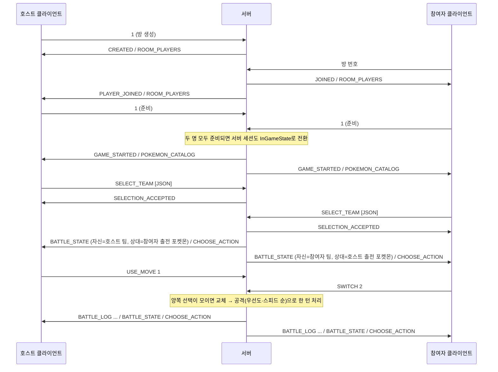

# Pokemon

C# / .NET 10 기반의 TCP 콘솔 포켓몬 게임입니다. 서버가 방과 플레이어 정보를 관리하고, 클라이언트는 사용자 입력을 전송하고 서버 응답에 따라 화면을 표시합니다.

현재는 두 플레이어의 준비, 포켓몬 3마리와 각각의 기술 4개 선택, 동시 선택 방식의 턴제 전투(공격·교체·기절 시 교체), 승패 표시까지 구현되어 있습니다.

**게임 로직을 추가할 때는 클라이언트와 서버의 `InGameState.cs`에서 시작합니다.** 클라이언트는 입력·결과 수신·화면 상태 갱신을, 서버는 명령 검증과 게임 진행 처리를 담당합니다.

## 프로젝트 구성

| 경로 | 역할 |
| --- | --- |
| [Client/Program.cs](Client/Program.cs) | 서버 연결, 입력·수신 이벤트 수집, 단일 이벤트 처리 루프 |
| [Client/scripts/States](Client/scripts/States) | 로비·방 안·게임 중 상태별 입력 및 서버 메시지 처리 |
| [Client/scripts/Renderers](Client/scripts/Renderers) | 인게임 화면 구성, 텍스트·타입 색상·포켓몬 그림 출력 |
| [Server/Program.cs](Server/Program.cs) | DB 로딩, TCP 연결 수락, 접속별 세션 실행 |
| [Server/scripts/ClientSession.cs](Server/scripts/ClientSession.cs) | 접속 하나의 명령 수신, 상태 위임, 응답 송신 |
| [Server/scripts/States](Server/scripts/States) | 서버에서 플레이어 상태별 명령 처리 |
| [Server/scripts/RoomManager.cs](Server/scripts/RoomManager.cs) | 방 생성·입장·퇴장, 준비, 포켓몬 선택 검증 및 양쪽 통지 |
| [Server/scripts/GameRoom.cs](Server/scripts/GameRoom.cs) | 호스트·참여자와 각자의 포켓몬 선택 보관 |
| [Shared/GameMessages.cs](Shared/GameMessages.cs) | 양쪽 프로젝트가 함께 사용하는 JSON 데이터 형식 |

## 통신 규칙

- 클라이언트마다 서버와 하나의 TCP 연결을 유지합니다. 방에서 나가도 연결을 유지하며, 다시 방을 만들거나 입장할 수 있습니다.
- 송신 문자열은 UTF-8로 인코딩하며, **줄바꿈(`\n`)으로 메시지 하나의 끝을 구분합니다.** JSON 데이터도 줄바꿈 없는 한 줄로 직렬화합니다.
- 클라이언트의 `StreamWriter`는 `AutoFlush = true`이므로 `WriteLineAsync()`로 보낸 명령이 바로 전송됩니다.
- 서버는 수신 데이터를 줄바꿈까지 모읍니다. TCP 수신 한 번에 명령이 나뉘거나 여러 개가 함께 들어와도 줄 단위로 처리합니다. CRLF의 `\r`도 제거합니다.
- 현재 클라이언트 요청은 숫자와 ASCII 명령, 숫자 필드로 구성된 JSON입니다. 서버의 현재 수신 구현은 바이트를 문자로 변환하므로, 한글 등 비ASCII 요청을 추가할 때는 UTF-8 디코딩 처리도 함께 바꿔야 합니다.
- 서버가 받는 명령은 줄바꿈을 제외하고 최대 256바이트입니다. 초과하면 연결을 종료합니다. 서버에서 클라이언트로 보내는 목록 JSON에는 이 제한을 적용하지 않습니다.
- 오류는 `ERROR 설명` 형식으로 보냅니다. 연결 종료는 스트림의 EOF로 감지합니다.

서버는 기본 포트 `5000`을 사용하며 실행 인자로 포트를 변경할 수 있습니다. 클라이언트의 실제 접속 대상은 현재 [Client/Program.cs](Client/Program.cs)의 `IPEndPoint`에 지정된 `192.168.16.1:5000`입니다. `host`, `port` 인자 처리도 있지만 실제 연결에는 아직 반영되지 않습니다.

## 상태별 명령

클라이언트와 서버 모두 `ClientState` 추상 클래스를 상속하는 `LobbyState`, `InRoomState`, `InGameState` 객체를 사용합니다. 같은 숫자도 현재 상태에 따라 의미가 달라집니다.

| 상태 | 사용자 입력 | 서버에 전송하는 명령 | 처리 |
| --- | --- | --- | --- |
| Lobby | `1` | `1` | 방 생성 |
| Lobby | `2` → 방 번호 입력 | 입력한 방 번호, 예: `1000` | 방 입장. 메뉴의 `2` 자체는 보내지 않음 |
| Lobby | `3` | `3` | 클라이언트 종료 |
| InRoom | `1` | `1` | 준비 |
| InRoom | `2` | `2` | 방에서 나가기 |
| InGame | 포켓몬 번호 3개 → 포켓몬마다 기술 번호 4개 | `SELECT_TEAM [JSON]` | 서로 다른 포켓몬 3마리를 먼저 고르고, 고른 순서대로 기술을 고른 뒤 한 번에 전송 |
| InGame (행동 선택) | `1` 싸운다 → 기술 `1`~`4` | `USE_MOVE <1~4>` | 출전 중인 포켓몬의 기술 슬롯 사용. `0`은 뒤로 |
| InGame (행동 선택) | `2` 교체 → 목록 번호 | `SWITCH <1~3>` | 출전하지 않았고 쓰러지지 않은 포켓몬으로 교체. `0`은 뒤로 |
| InGame (기절 후) | 목록 번호 | `SWITCH <1~3>` | 쓰러진 포켓몬 대신 내보낼 포켓몬. 뒤로 갈 수 없음 |

포켓몬 선택 단계의 포켓몬 번호와 기술 번호는 DB의 ID입니다. `USE_MOVE`의 숫자는 출전 중인 포켓몬의 기술 4개 중 몇 번째 슬롯인지, `SWITCH`의 숫자는 팀 번호(선택한 순서 1~3)를 뜻합니다. 클라이언트 교체 목록의 번호는 교체 가능한 포켓몬만 다시 매긴 것이므로 팀 번호로 바꿔서 보냅니다.

## 서버 응답

`{...}`와 `<...>`는 설명을 위한 자리표시자입니다. 실제 메시지에는 해당 값이나 JSON이 들어갑니다.

| 메시지 | 의미와 클라이언트 처리 |
| --- | --- |
| `CREATED <방 번호> <호스트 주소>` | 생성 완료. `InRoomState`로 전환 |
| `JOINED <방 번호> <호스트 주소>` | 입장 완료. `InRoomState`로 전환 |
| `PLAYER_JOINED` | 상대 입장 알림 |
| `PLAYER_LEFT` | 상대 퇴장·연결 종료 알림 |
| `ROOM_PLAYERS <방 번호> <호스트 주소> <준비> [참여자 주소] [준비]` | 현재 플레이어 목록. 준비 값은 `0` 또는 `1`. 참여자가 없으면 참여자 부분 생략 |
| `READY` | 자신의 준비 완료 |
| `PLAYER_READY` | 상대방의 준비 완료 |
| `LEFT` | 자신의 퇴장 완료. `LobbyState`로 전환 |
| `ROOM_CLOSED` | 호스트 퇴장으로 방 종료. 참여자는 `LobbyState`로 전환 |
| `GAME_STARTED` | 두 플레이어 모두 준비 완료. `InGameState`로 전환 |
| `POKEMON_CATALOG {JSON}` | 포켓몬·타입·기술·배울 수 있는 기술 목록 |
| `SELECTION_ACCEPTED` | 자신의 포켓몬·기술 선택 승인 |
| `BATTLE_STATE {JSON}` | 전투 화면 정보(`BattleView`). 내 팀 3마리(HP·기술), 출전 번호, 상대 출전 포켓몬. 첫 수신 시 전투 화면으로 전환하고, 매 턴·교체 후 다시 전송 |
| `BATTLE_LOG <문장>` | 받는 플레이어 시점의 전투 기록. 예: `내 파이리의 화염방사! 효과가 굉장했다! (180 데미지)` |
| `CHOOSE_ACTION` | 이번 턴 행동(싸운다/교체) 선택 |
| `CHOOSE_SWITCH` | 출전 포켓몬이 쓰러짐. 내보낼 포켓몬 선택 |
| `WAIT_SWITCH` | 상대가 쓰러진 포켓몬 대신 내보낼 포켓몬을 고르는 중 |
| `BATTLE_END <WIN\|LOSE>` | 한쪽 팀 3마리가 모두 쓰러져 전투 종료. 결과 화면에 재도전·나가기 메뉴 표시(아직 동작하지 않음) |
| `RETURN_TO_ROOM <방 번호> <호스트 주소>` | 인게임에서 참여자 연결이 종료됐을 때 호스트를 `InRoomState`로 복귀 |
| `ERROR <설명>` | 명령 오류 또는 선택 검증 실패 |

주소는 서버에서 확인한 클라이언트의 원격 엔드포인트로, `IP:포트` 형식입니다.

## 준비부터 포켓몬 표시까지



`SELECT_TEAM`의 형식 예시는 다음과 같습니다. 첫 번째 포켓몬이 먼저 출전합니다. 3마리 모두 길이 256바이트 제한 안에 들어갑니다.

```text
SELECT_TEAM [{"PokemonId":4,"MoveIds":[53,394,200,264]},{"PokemonId":25,"MoveIds":[85,87,70,84]},{"PokemonId":7,"MoveIds":[57,56,401,130]}]
```

서버는 포켓몬 수(3마리), 포켓몬 중복, 포켓몬 존재 여부, 기술 개수·중복·습득 가능 여부를 검증합니다. 먼저 선택한 플레이어는 상대방의 선택을 기다립니다. 양쪽 선택이 완료되면 각 클라이언트의 관점에 맞춘 `BattleView`를 전송합니다.

공통 데이터 정의는 [Shared/GameMessages.cs](Shared/GameMessages.cs)에 있습니다. 포켓몬·기술·전투 결과의 전송 필드를 추가할 때는 이 파일도 함께 변경합니다.

## 클라이언트의 이벤트 처리와 렌더링

```text
콘솔 입력 ── ReadInputEventsAsync ─┐
                                 ├─ Channel<ClientEvent> ─ ProcessEventsAsync
서버 응답 ── ReceiveMessagesAsync ┘                           │
                                                            ├─ state.HandleCommand(...)
                                                            ├─ state.HandleServerMessage(...)
                                                            └─ state.ShowMenu()
```

입력·수신 작업은 이벤트를 큐에 넣기만 합니다. 단일 처리 루프가 현재 상태에 이벤트를 위임하고, 처리가 끝나면 화면을 다시 그립니다. 상태 변경과 메뉴 출력을 다른 작업에서 동시에 수행하지 않습니다.

`InGameState.ShowMenu()`는 [InGameRenderer](Client/scripts/Renderers/InGameRenderer.cs)에 화면 구성을 위임합니다.

| 렌더러 | 담당 |
| --- | --- |
| `InGameRenderer` | 포켓몬 목록·기술 목록·선택 대기·두 포켓몬 화면의 배치와 출력 순서 |
| `TextRenderer` | 텍스트 출력, 좌표 출력, 한글 표시 폭과 정렬 |
| `TypeColorRenderer` | 타입 HEX 색상을 적용한 마커 출력 |
| `PokemonRenderer` | ANSI 컬러 TXT 로딩, 표시 크기 조정, 좌우 반전과 그림 출력 |

알림은 상태의 `Notification`에 저장하고 메뉴와 함께 출력합니다. 렌더러에서는 입력이나 서버 응답을 기다리지 않습니다.

## 게임 로직을 구현할 위치

### 클라이언트: `Client/scripts/States/InGameState.cs`

- `HandleCommand()`: 사용자 입력을 확인하고 서버에 명령을 전송합니다. 전투 중 입력은 `HandleBattleInput()`이 메뉴 단계(싸운다/교체/기술/교체 목록/대기)에 따라 처리합니다.
- `HandleServerMessage()`: 서버가 보낸 전투 결과를 해석하고 `battle` 및 `Notification`을 갱신합니다.
- `ShowMenu()`: 갱신된 상태를 `InGameRenderer`로 전달합니다.

### 서버: `Server/scripts/States/InGameState.cs`

- `HandleCommand()`: 클라이언트의 인게임 명령을 구분하고 형식을 검사합니다.
- 양쪽 선택을 모으는 작업과 방 공유 데이터 변경은 `RoomManager` 등의 서버 로직에 위임합니다.
- 공격 순서, 명중 여부, 데미지, HP, 승패는 서버에서 판정하고 결과를 양쪽 클라이언트에 전달하도록 구현합니다.

타입 상성에 따른 데미지 배율은 [Server/scripts/GameData.cs](Server/scripts/GameData.cs)의 `GetMultiplier(int attackTypeId, int defendTypeId)`로 조회할 수 있습니다. 공격 기술의 타입 ID와 방어 포켓몬의 타입 ID를 순서대로 전달하면 두 타입의 상성 배율을 `double`로 반환합니다.
GameData 객체의 경우 RoomManager 객체가 소유하고 있습니다.
상태이상 정보나 기술의 상태이상 적용 확률도 DB에 저장되어 있습니다. DB 테이블의 구조를 확인하려면 VSCode의 SQLite Viewer 플러그를 설치하시면 됩니다.

```csharp
double multiplier = data.GetMultiplier(move.TypeId, defender.Type1Id);
```

기술별 상태이상 정보는 `data.MoveStatusEffectsByMoveId[move.Id]`, 상태 정의는 `data.StatusConditionsById[effect.StatusId]`로 조회합니다. 확률뿐 아니라 적용 대상·시점·추첨 그룹도 함께 확인해야 합니다. 데이터 범위와 필드 의미는 [DB 설명](Server/resources/db/README.md)에 정리되어 있습니다. 현재는 정의와 읽기 전용 적재까지 구현되어 있으며, 실제 상태 적용·해제와 턴 처리는 전투 로직에서 구현해야 합니다.

예를 들어 기술 사용 기능은 다음 순서로 추가합니다.

```text
클라이언트 InGameState.HandleCommand
→ USE_MOVE <1~4 슬롯> 전송
→ 서버 InGameState.HandleCommand
→ RoomManager.UseMove / SwitchPokemon에서 전투 상태 검증 및 양쪽 선택 수집
→ 서버에서 턴 계산 후 결과 전송
→ 클라이언트 InGameState.HandleServerMessage에서 상태 갱신
→ 이벤트 처리 루프가 화면 출력
```

### 현재 구현된 전투

- 양쪽 팀 선택이 끝나면 서버가 플레이어마다 [BattleSide](Server/scripts/BattleSide.cs)(팀, 출전 번호, 이번 턴 선택)를 만들고, 포켓몬마다 [BattlePokemon](Server/scripts/BattlePokemon.cs)을 만듭니다. 레벨 50, 개체값 31(6V), 노력치 0, 성격 보정 없이 실제 능력치를 계산합니다(HP = 종족값 + 75, 나머지 = 종족값 + 20).
- 매 턴 양쪽이 동시에 기술(`RoomManager.UseMove`) 또는 교체(`RoomManager.SwitchPokemon`)를 고릅니다. 둘 다 고르면 `RoomManager.TryResolveTurn`이 교체를 먼저 처리한 뒤, 우선도 → 스피드 → 무작위 순으로 공격합니다. 그래서 상대가 교체하면 공격은 새로 나온 포켓몬이 맞습니다.
- 이번 턴에 먼저 쓰러진 포켓몬은 공격하지 못합니다. 쓰러진 쪽은 다음 포켓몬을 골라야 하며(`CHOOSE_SWITCH`), 이 교체는 턴을 쓰지 않아 상대가 추가로 공격하지 않습니다. 팀 3마리가 모두 쓰러지면 패배입니다.
- 데미지는 5세대 공식으로 계산합니다(`RoomManager.ApplyMove`). 물리/특수 구분, 타입 상성(듀얼 타입은 곱함), 자속 1.5배, 난수 0.85~1.00, 명중률을 반영합니다. 급소·날씨·특성·아이템·랭크 변화·연속기 횟수·PP는 아직 반영하지 않습니다.
- 변화 기술과 위력 값이 없는 기술은 사용하면 턴만 넘어가고 "아직 구현되지 않은 기술"로 표시됩니다.
- 전투 기록 문장은 서버가 플레이어마다 시점("내"/"상대")에 맞춰 만들어 `BATTLE_LOG`로 보냅니다. 클라이언트는 최근 5줄을 표시합니다.
- 전투가 끝나면 `BATTLE_END`를 보내고, 클라이언트는 WIN/LOSE와 재도전·나가기 메뉴를 표시합니다. 메뉴 선택은 아직 동작하지 않습니다.
- 전투 화면은 76열 × 27행 이상의 터미널이 필요합니다.

클라이언트의 연결 주소에 IPv4 주소는 자신의 컴퓨터 IPv4 주소로 변경해야 합니다. IPEndPoint ipep = new IPEndPoint(IPAddress.Parse("192.168.16.1"), 5000); << 해당부분, cmd 명령어 : ipconfig


