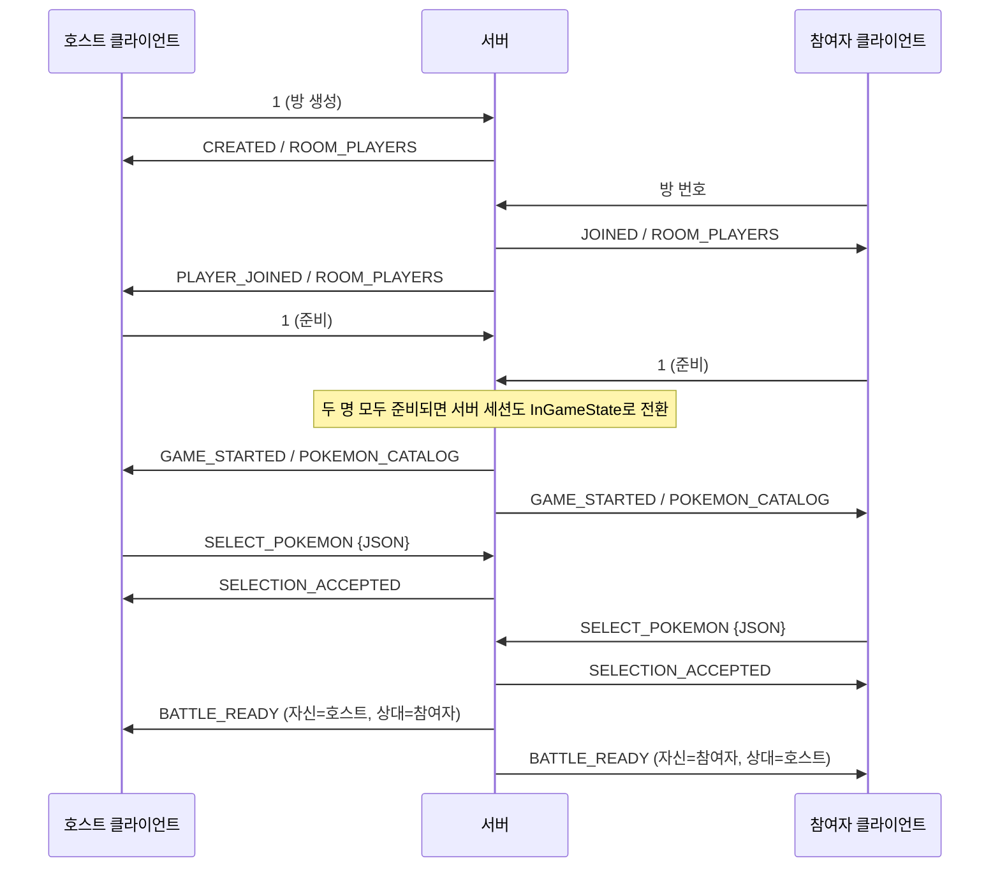

# Pokemon

C# / .NET 10 기반의 TCP 콘솔 포켓몬 게임입니다. 서버가 방과 플레이어 정보를 관리하고, 클라이언트는 사용자 입력을 전송하고 서버 응답에 따라 화면을 표시합니다.

현재는 두 플레이어의 준비, 포켓몬 1마리와 서로 다른 기술 4개 선택, 양쪽 포켓몬 표시까지 구현되어 있습니다.

**게임 로직을 추가할 때는 클라이언트와 서버의 `InGameState.cs`에서 시작합니다.** 클라이언트는 입력·결과 수신·화면 상태 갱신을, 서버는 명령 검증과 게임 진행 처리를 담당합니다.

## 프로젝트 구성

| 경로 | 역할 |
| --- | --- |
| [Client/Program.cs](Client/Program.cs) | 서버 연결, 입력·수신 이벤트 수집, 단일 이벤트 처리 루프 |
| [Client/scripts/States](Client/scripts/States) | 로비·방 안·게임 중 상태별 입력 및 서버 메시지 처리 |
| [Client/scripts/Renderers](Client/scripts/Renderers) | 인게임 화면 구성, 텍스트·타입 색상·포켓몬 그림 출력 |
| [Server/Program.cs](Server/Program.cs) | DB 로딩, TCP 연결 수락, 접속별 세션 실행 |
| [Server/scripts/ClientSession.cs](Server/scripts/ClientSession.cs) | 접속 하나의 명령 수신, 상태 위임, 응답 송신 |
| [Server/scripts/States](Server/scripts/States) | 서버에서 플레이어 상태별 명령 처리 |
| [Server/scripts/RoomManager.cs](Server/scripts/RoomManager.cs) | 방 생성·입장·퇴장, 준비, 포켓몬 선택 검증 및 양쪽 통지 |
| [Server/scripts/GameRoom.cs](Server/scripts/GameRoom.cs) | 호스트·참여자와 각자의 포켓몬 선택 보관 |
| [Shared/GameMessages.cs](Shared/GameMessages.cs) | 양쪽 프로젝트가 함께 사용하는 JSON 데이터 형식 |

## 통신 규칙

- 클라이언트마다 서버와 하나의 TCP 연결을 유지합니다. 방에서 나가도 연결을 유지하며, 다시 방을 만들거나 입장할 수 있습니다.
- 송신 문자열은 UTF-8로 인코딩하며, **줄바꿈(`\n`)으로 메시지 하나의 끝을 구분합니다.** JSON 데이터도 줄바꿈 없는 한 줄로 직렬화합니다.
- 클라이언트의 `StreamWriter`는 `AutoFlush = true`이므로 `WriteLineAsync()`로 보낸 명령이 바로 전송됩니다.
- 서버는 수신 데이터를 줄바꿈까지 모읍니다. TCP 수신 한 번에 명령이 나뉘거나 여러 개가 함께 들어와도 줄 단위로 처리합니다. CRLF의 `\r`도 제거합니다.
- 현재 클라이언트 요청은 숫자와 ASCII 명령, 숫자 필드로 구성된 JSON입니다. 서버의 현재 수신 구현은 바이트를 문자로 변환하므로, 한글 등 비ASCII 요청을 추가할 때는 UTF-8 디코딩 처리도 함께 바꿔야 합니다.
- 서버가 받는 명령은 줄바꿈을 제외하고 최대 256바이트입니다. 초과하면 연결을 종료합니다. 서버에서 클라이언트로 보내는 목록 JSON에는 이 제한을 적용하지 않습니다.
- 오류는 `ERROR 설명` 형식으로 보냅니다. 연결 종료는 스트림의 EOF로 감지합니다.

서버는 기본 포트 `5000`을 사용하며 실행 인자로 포트를 변경할 수 있습니다. 클라이언트의 실제 접속 대상은 현재 [Client/Program.cs](Client/Program.cs)의 `IPEndPoint`에 지정된 `192.168.16.1:5000`입니다. `host`, `port` 인자 처리도 있지만 실제 연결에는 아직 반영되지 않습니다.

## 상태별 명령

클라이언트와 서버 모두 `ClientState` 추상 클래스를 상속하는 `LobbyState`, `InRoomState`, `InGameState` 객체를 사용합니다. 같은 숫자도 현재 상태에 따라 의미가 달라집니다.

| 상태 | 사용자 입력 | 서버에 전송하는 명령 | 처리 |
| --- | --- | --- | --- |
| Lobby | `1` | `1` | 방 생성 |
| Lobby | `2` → 방 번호 입력 | 입력한 방 번호, 예: `1000` | 방 입장. 메뉴의 `2` 자체는 보내지 않음 |
| Lobby | `3` | `3` | 클라이언트 종료 |
| InRoom | `1` | `1` | 준비 |
| InRoom | `2` | `2` | 방에서 나가기 |
| InGame | 포켓몬 번호 → 기술 번호 4개 | `SELECT_POKEMON {JSON}` | 선택을 로컬에서 모은 뒤 한 번에 전송 |

현재 인게임의 포켓몬 번호와 기술 번호는 DB의 ID입니다. 이후 전투용 `USE_MOVE 1` 같은 명령을 추가한다면 `1`은 선택한 기술 4개 중 첫 번째 슬롯이라는 의미로 구분합니다.

## 서버 응답

`{...}`와 `<...>`는 설명을 위한 자리표시자입니다. 실제 메시지에는 해당 값이나 JSON이 들어갑니다.

| 메시지 | 의미와 클라이언트 처리 |
| --- | --- |
| `CREATED <방 번호> <호스트 주소>` | 생성 완료. `InRoomState`로 전환 |
| `JOINED <방 번호> <호스트 주소>` | 입장 완료. `InRoomState`로 전환 |
| `PLAYER_JOINED` | 상대 입장 알림 |
| `PLAYER_LEFT` | 상대 퇴장·연결 종료 알림 |
| `ROOM_PLAYERS <방 번호> <호스트 주소> <준비> [참여자 주소] [준비]` | 현재 플레이어 목록. 준비 값은 `0` 또는 `1`. 참여자가 없으면 참여자 부분 생략 |
| `READY` | 자신의 준비 완료 |
| `PLAYER_READY` | 상대방의 준비 완료 |
| `LEFT` | 자신의 퇴장 완료. `LobbyState`로 전환 |
| `ROOM_CLOSED` | 호스트 퇴장으로 방 종료. 참여자는 `LobbyState`로 전환 |
| `GAME_STARTED` | 두 플레이어 모두 준비 완료. `InGameState`로 전환 |
| `POKEMON_CATALOG {JSON}` | 포켓몬·타입·기술·배울 수 있는 기술 목록 |
| `SELECTION_ACCEPTED` | 자신의 포켓몬·기술 선택 승인 |
| `BATTLE_READY {JSON}` | 양쪽 선택 완료. 자신의 포켓몬·상대 포켓몬·자신의 기술 정보로 화면 구성 |
| `RETURN_TO_ROOM <방 번호> <호스트 주소>` | 인게임에서 참여자 연결이 종료됐을 때 호스트를 `InRoomState`로 복귀 |
| `ERROR <설명>` | 명령 오류 또는 선택 검증 실패 |

주소는 서버에서 확인한 클라이언트의 원격 엔드포인트로, `IP:포트` 형식입니다.

## 준비부터 포켓몬 표시까지



`SELECT_POKEMON`의 형식 예시는 다음과 같습니다. 실제 선택은 해당 포켓몬이 배울 수 있는 서로 다른 기술 4개여야 합니다.

```text
SELECT_POKEMON {"PokemonId":1,"MoveIds":[33,45,73,22]}
```

서버는 포켓몬 존재 여부, 기술 개수, 중복 여부, 습득 가능 여부를 검증합니다. 먼저 선택한 플레이어는 상대방의 선택을 기다립니다. 양쪽 선택이 완료되면 각 클라이언트의 관점에 맞춘 `BattleView`를 전송합니다.

공통 데이터 정의는 [Shared/GameMessages.cs](Shared/GameMessages.cs)에 있습니다. 포켓몬·기술·전투 결과의 전송 필드를 추가할 때는 이 파일도 함께 변경합니다.

## 클라이언트의 이벤트 처리와 렌더링

```text
콘솔 입력 ── ReadInputEventsAsync ─┐
                                 ├─ Channel<ClientEvent> ─ ProcessEventsAsync
서버 응답 ── ReceiveMessagesAsync ┘                           │
                                                            ├─ state.HandleCommand(...)
                                                            ├─ state.HandleServerMessage(...)
                                                            └─ state.ShowMenu()
```

입력·수신 작업은 이벤트를 큐에 넣기만 합니다. 단일 처리 루프가 현재 상태에 이벤트를 위임하고, 처리가 끝나면 화면을 다시 그립니다. 상태 변경과 메뉴 출력을 다른 작업에서 동시에 수행하지 않습니다.

`InGameState.ShowMenu()`는 [InGameRenderer](Client/scripts/Renderers/InGameRenderer.cs)에 화면 구성을 위임합니다.

| 렌더러 | 담당 |
| --- | --- |
| `InGameRenderer` | 포켓몬 목록·기술 목록·선택 대기·두 포켓몬 화면의 배치와 출력 순서 |
| `TextRenderer` | 텍스트 출력, 좌표 출력, 한글 표시 폭과 정렬 |
| `TypeColorRenderer` | 타입 HEX 색상을 적용한 마커 출력 |
| `PokemonRenderer` | ANSI 컬러 TXT 로딩, 표시 크기 조정, 좌우 반전과 그림 출력 |

알림은 상태의 `Notification`에 저장하고 메뉴와 함께 출력합니다. 렌더러에서는 입력이나 서버 응답을 기다리지 않습니다.

## 게임 로직을 구현할 위치

### 클라이언트: `Client/scripts/States/InGameState.cs`

- `HandleCommand()`: 전투 중 기술 슬롯 등 사용자 입력을 확인하고 서버에 명령을 전송합니다. 현재는 `battle != null` 분기에서 안내 문구만 설정합니다.
- `HandleServerMessage()`: 서버가 보낸 전투 결과를 해석하고 `battle` 및 `Notification`을 갱신합니다.
- `ShowMenu()`: 갱신된 상태를 `InGameRenderer`로 전달합니다.

### 서버: `Server/scripts/States/InGameState.cs`

- `HandleCommand()`: 클라이언트의 인게임 명령을 구분하고 형식을 검사합니다.
- 양쪽 선택을 모으는 작업과 방 공유 데이터 변경은 `RoomManager` 등의 서버 로직에 위임합니다.
- 공격 순서, 명중 여부, 데미지, HP, 승패는 서버에서 판정하고 결과를 양쪽 클라이언트에 전달하도록 구현합니다.

타입 상성에 따른 데미지 배율은 [Server/scripts/GameData.cs](Server/scripts/GameData.cs)의 94번째 줄부터 설명된 `GetMultiplier(int attackTypeId, int defendTypeId)`로 조회할 수 있습니다. 공격 기술의 타입 ID와 방어 포켓몬의 타입 ID를 순서대로 전달하면 두 타입의 상성 배율을 `double`로 반환합니다.
GameData 객체의 경우 RoomManager 객체가 소유하고 있습니다.

```csharp
double multiplier = data.GetMultiplier(move.TypeId, defender.Type1Id);
```

예를 들어 기술 사용 기능은 다음 순서로 추가합니다.

```text
클라이언트 InGameState.HandleCommand
→ USE_MOVE <1~4 슬롯> 전송
→ 서버 InGameState.HandleCommand
→ RoomManager.SelectMove 등에서 전투 준비 여부 검증 및 양쪽 선택 수집
→ 서버에서 턴 계산 후 결과 전송
→ 클라이언트 InGameState.HandleServerMessage에서 상태 갱신
→ 이벤트 처리 루프가 화면 출력
```

**현재 `USE_MOVE`는 양쪽 `InGameState.cs`에 주석 예시만 있고 실제로 동작하지 않습니다. `RoomManager.SelectMove()`와 공격·데미지·턴·승패 처리는 아직 구현되지 않았습니다.** 현재 동작하는 인게임 명령은 `SELECT_POKEMON`이며, 이후 화면에는 두 포켓몬과 선택한 기술까지 표시됩니다.또한 현재는 PokemonSelection 타입으로 선택된 포켓몬 객체가 생성되며 실제 인게임 상태 정보를 유지하는 포켓몬 객체는 정의되어 있지 않습니다. DB에는 포켓몬의 기본 개체값 스테이터스만 있으므로 실제 포켓몬 객체는 스테이터스 계산 식을 사용하여 스텟이 계산되어 적용되어야 합니다(50레벨 6v 기준으로 하면 될 듯).


